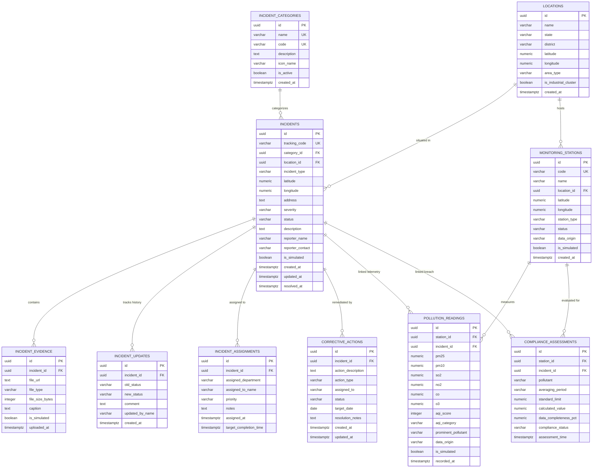

# EcoSentinel AI - Unified Database Schema Specification

**Database Engine:** PostgreSQL (Supabase Managed Cloud)  
**Schema Architecture:** Unified Multi-Domain Environmental & Incident Data Model  
**Schema Version:** 2.0.0 (Unified 10-Table Architecture)  
**Official References:** CPCB NAAQS 2009 Gazette, CPCB National AQI 2014, NDMA Incident Command Guidelines  

---

## 1. Unified Entity-Relationship Diagram (ERD)



---

## 2. Table Specifications & PostgreSQL DDL

### 2.1 Table: `incident_categories`
Lookup table defining the 4 core domains.

```sql
CREATE TABLE incident_categories (
    id UUID PRIMARY KEY DEFAULT gen_random_uuid(),
    name VARCHAR(100) NOT NULL UNIQUE,
    code VARCHAR(50) NOT NULL UNIQUE,
    description TEXT,
    icon_name VARCHAR(50) NOT NULL,
    is_active BOOLEAN NOT NULL DEFAULT true,
    created_at TIMESTAMPTZ NOT NULL DEFAULT NOW()
);
```

### 2.2 Table: `locations`
Geographic registry supporting regional centers and industrial clusters.

```sql
CREATE TABLE locations (
    id UUID PRIMARY KEY DEFAULT gen_random_uuid(),
    name VARCHAR(150) NOT NULL,
    state VARCHAR(100) NOT NULL,
    district VARCHAR(100) NOT NULL,
    latitude NUMERIC(10, 7) NOT NULL,
    longitude NUMERIC(10, 7) NOT NULL,
    area_type VARCHAR(50) NOT NULL DEFAULT 'Industrial', -- 'Industrial', 'Residential', 'Ecologically_Sensitive'
    is_industrial_cluster BOOLEAN NOT NULL DEFAULT false,
    created_at TIMESTAMPTZ NOT NULL DEFAULT NOW()
);
```

### 2.3 Table: `incidents`
Core multi-domain incident repository.

```sql
CREATE TABLE incidents (
    id UUID PRIMARY KEY DEFAULT gen_random_uuid(),
    tracking_code VARCHAR(30) NOT NULL UNIQUE,
    category_id UUID NOT NULL REFERENCES incident_categories(id) ON DELETE RESTRICT,
    location_id UUID REFERENCES locations(id) ON DELETE SET NULL,
    incident_type VARCHAR(100) NOT NULL,
    latitude NUMERIC(10, 7) NOT NULL,
    longitude NUMERIC(10, 7) NOT NULL,
    address TEXT NOT NULL,
    severity VARCHAR(20) NOT NULL CHECK (severity IN ('Low', 'Moderate', 'High', 'Critical')),
    status VARCHAR(30) NOT NULL DEFAULT 'Submitted' CHECK (status IN (
        'Submitted', 'Under Review', 'Verified', 'Assigned', 'In Progress', 'Resolved', 'Closed', 'Rejected'
    )),
    description TEXT NOT NULL,
    reporter_name VARCHAR(120),
    reporter_contact VARCHAR(100),
    is_simulated BOOLEAN NOT NULL DEFAULT true,
    created_at TIMESTAMPTZ NOT NULL DEFAULT NOW(),
    updated_at TIMESTAMPTZ NOT NULL DEFAULT NOW(),
    resolved_at TIMESTAMPTZ
);

CREATE INDEX idx_incidents_category ON incidents(category_id);
CREATE INDEX idx_incidents_status ON incidents(status);
CREATE INDEX idx_incidents_severity ON incidents(severity);
CREATE INDEX idx_incidents_created_at ON incidents(created_at DESC);
```

### 2.4 Table: `incident_evidence`
Photographs, documents, or sensor captures supporting incident reports.

```sql
CREATE TABLE incident_evidence (
    id UUID PRIMARY KEY DEFAULT gen_random_uuid(),
    incident_id UUID NOT NULL REFERENCES incidents(id) ON DELETE CASCADE,
    file_url TEXT NOT NULL,
    file_type VARCHAR(50) NOT NULL,
    file_size_bytes INTEGER,
    caption TEXT,
    is_simulated BOOLEAN NOT NULL DEFAULT true,
    uploaded_at TIMESTAMPTZ NOT NULL DEFAULT NOW()
);

CREATE INDEX idx_evidence_incident ON incident_evidence(incident_id);
```

### 2.5 Table: `incident_updates`
Chronological state transition and commentary audit trail.

```sql
CREATE TABLE incident_updates (
    id UUID PRIMARY KEY DEFAULT gen_random_uuid(),
    incident_id UUID NOT NULL REFERENCES incidents(id) ON DELETE CASCADE,
    old_status VARCHAR(30),
    new_status VARCHAR(30) NOT NULL,
    comment TEXT NOT NULL,
    updated_by_name VARCHAR(120) NOT NULL,
    created_at TIMESTAMPTZ NOT NULL DEFAULT NOW()
);

CREATE INDEX idx_updates_incident ON incident_updates(incident_id);
```

### 2.6 Table: `incident_assignments`
Formal dispatch and agency assignment tracking.

```sql
CREATE TABLE incident_assignments (
    id UUID PRIMARY KEY DEFAULT gen_random_uuid(),
    incident_id UUID NOT NULL REFERENCES incidents(id) ON DELETE CASCADE,
    assigned_department VARCHAR(150) NOT NULL,
    assigned_to_name VARCHAR(120),
    priority VARCHAR(20) NOT NULL CHECK (priority IN ('Normal', 'High', 'Urgent', 'Immediate')),
    notes TEXT,
    assigned_at TIMESTAMPTZ NOT NULL DEFAULT NOW(),
    target_completion_time TIMESTAMPTZ
);

CREATE INDEX idx_assignments_incident ON incident_assignments(incident_id);
```

### 2.7 Table: `corrective_actions`
Formal Corrective and Preventive Actions (CAPA) tracking.

```sql
CREATE TABLE corrective_actions (
    id UUID PRIMARY KEY DEFAULT gen_random_uuid(),
    incident_id UUID NOT NULL REFERENCES incidents(id) ON DELETE CASCADE,
    action_description TEXT NOT NULL,
    action_type VARCHAR(50) NOT NULL DEFAULT 'Corrective', -- 'Corrective', 'Preventive', 'Engineering', 'Civic'
    assigned_to VARCHAR(120) NOT NULL,
    status VARCHAR(30) NOT NULL DEFAULT 'Open' CHECK (status IN ('Open', 'In Progress', 'Completed', 'Verified')),
    target_date DATE NOT NULL,
    resolution_notes TEXT,
    created_at TIMESTAMPTZ NOT NULL DEFAULT NOW(),
    updated_at TIMESTAMPTZ NOT NULL DEFAULT NOW()
);

CREATE INDEX idx_corrective_actions_incident ON corrective_actions(incident_id);
```

### 2.8 Table: `monitoring_stations`
Continuous ambient air quality monitoring stations (CAAQMS).

```sql
CREATE TABLE monitoring_stations (
    id UUID PRIMARY KEY DEFAULT gen_random_uuid(),
    code VARCHAR(50) NOT NULL UNIQUE,
    name VARCHAR(150) NOT NULL,
    location_id UUID REFERENCES locations(id) ON DELETE SET NULL,
    latitude NUMERIC(10, 7) NOT NULL,
    longitude NUMERIC(10, 7) NOT NULL,
    station_type VARCHAR(50) NOT NULL DEFAULT 'Industrial', -- 'Industrial', 'Commercial', 'Residential'
    status VARCHAR(30) NOT NULL DEFAULT 'Active' CHECK (status IN ('Active', 'Maintenance', 'Offline')),
    data_origin VARCHAR(50) NOT NULL DEFAULT 'SIMULATED' CHECK (data_origin IN ('SIMULATED', 'VERIFIED_MONITORING')),
    is_simulated BOOLEAN NOT NULL DEFAULT true,
    created_at TIMESTAMPTZ NOT NULL DEFAULT NOW()
);
```

### 2.9 Table: `pollution_readings`
Time-series air quality telemetry with explicit provenance.

```sql
CREATE TABLE pollution_readings (
    id UUID PRIMARY KEY DEFAULT gen_random_uuid(),
    station_id UUID NOT NULL REFERENCES monitoring_stations(id) ON DELETE CASCADE,
    incident_id UUID REFERENCES incidents(id) ON DELETE SET NULL, -- Optional link if reading prompted incident
    pm25 NUMERIC(6, 2),
    pm10 NUMERIC(6, 2),
    so2 NUMERIC(6, 2),
    no2 NUMERIC(6, 2),
    co NUMERIC(6, 2),
    o3 NUMERIC(6, 2),
    aqi_score INTEGER,
    aqi_category VARCHAR(30),
    prominent_pollutant VARCHAR(20),
    data_origin VARCHAR(50) NOT NULL DEFAULT 'SIMULATED' CHECK (data_origin IN ('SIMULATED', 'VERIFIED_MONITORING')),
    is_simulated BOOLEAN NOT NULL DEFAULT true,
    recorded_at TIMESTAMPTZ NOT NULL DEFAULT NOW()
);

CREATE INDEX idx_readings_station_time ON pollution_readings(station_id, recorded_at DESC);
```

### 2.10 Table: `compliance_assessments`
Statutory evaluation records against CPCB NAAQS 2009 standards.

```sql
CREATE TABLE compliance_assessments (
    id UUID PRIMARY KEY DEFAULT gen_random_uuid(),
    station_id UUID NOT NULL REFERENCES monitoring_stations(id) ON DELETE CASCADE,
    incident_id UUID REFERENCES incidents(id) ON DELETE SET NULL, -- Links to created breach incident
    pollutant VARCHAR(20) NOT NULL,
    averaging_period VARCHAR(20) NOT NULL CHECK (averaging_period IN ('24h', '8h', '1h', 'Annual')),
    standard_limit NUMERIC(8, 2) NOT NULL,
    calculated_value NUMERIC(8, 2) NOT NULL,
    data_completeness_pct NUMERIC(5, 2) NOT NULL,
    compliance_status VARCHAR(40) NOT NULL CHECK (compliance_status IN ('COMPLIANT', 'STATUTORY_BREACH', 'INSUFFICIENT_DATA_CAPTURE')),
    assessment_time TIMESTAMPTZ NOT NULL DEFAULT NOW()
);

CREATE INDEX idx_compliance_station_time ON compliance_assessments(station_id, assessment_time DESC);
```

---

## 3. Seed Data Specification

The following realistic seed records cover all 4 domains, monitoring stations, and statutory compliance checks.

```sql
-- 1. Insert Incident Categories
INSERT INTO incident_categories (id, name, code, description, icon_name) VALUES
('c1000000-0000-0000-0000-000000000001', 'Environmental Pollution', 'ENVIRONMENTAL', 'Air pollution, hazardous chemical leaks, water effluent and illegal dumping.', 'Leaf'),
('c1000000-0000-0000-0000-000000000002', 'Natural Disasters', 'NATURAL_DISASTER', 'Floods, waterlogging, earthquakes, landslides, cyclones and heatwaves.', 'CloudRain'),
('c1000000-0000-0000-0000-000000000003', 'Accidents & Emergencies', 'ACCIDENT_EMERGENCY', 'Industrial explosions, building fires, toxic gas leaks, and road collisions.', 'Flame'),
('c1000000-0000-0000-0000-000000000004', 'Public Infrastructure', 'INFRASTRUCTURE', 'Severe potholes, broken drainage, raw sewage overflows, and fallen trees.', 'Wrench');

-- 2. Insert Locations
INSERT INTO locations (id, name, state, district, latitude, longitude, area_type, is_industrial_cluster) VALUES
('03000000-0000-0000-0000-000000000001', 'Vapi GIDC Chemical Estate', 'Gujarat', 'Valsad', 20.3712000, 72.9106000, 'Industrial', true),
('03000000-0000-0000-0000-000000000002', 'Manesar IMT Automotive Belt', 'Haryana', 'Gurugram', 28.3518000, 76.9412000, 'Industrial', true),
('03000000-0000-0000-0000-000000000003', 'Tarapur MIDC Heavy Engineering', 'Maharashtra', 'Palghar', 19.8080000, 72.6950000, 'Industrial', true),
('03000000-0000-0000-0000-000000000004', 'Surat Ring Road Corridor', 'Gujarat', 'Surat', 21.1702000, 72.8311000, 'Residential', false);

-- 3. Insert Monitoring Stations
INSERT INTO monitoring_stations (id, code, name, location_id, latitude, longitude, station_type, status, data_origin, is_simulated) VALUES
('04000000-0000-0000-0000-000000000001', 'STA-GJ-VAPI-01', 'Vapi GIDC Central CAAQMS', '03000000-0000-0000-0000-000000000001', 20.3712000, 72.9106000, 'Industrial', 'Active', 'SIMULATED', true),
('04000000-0000-0000-0000-000000000002', 'STA-HR-MANE-02', 'Manesar IMT East Sector 8', '03000000-0000-0000-0000-000000000002', 28.3518000, 76.9412000, 'Industrial', 'Active', 'SIMULATED', true),
('04000000-0000-0000-0000-000000000003', 'STA-MH-TARA-03', 'Tarapur Zone III Monitoring Post', '03000000-0000-0000-0000-000000000003', 19.8080000, 72.6950000, 'Industrial', 'Active', 'SIMULATED', true);

-- 4. Insert Multi-Domain Incidents
INSERT INTO incidents (id, tracking_code, category_id, location_id, incident_type, latitude, longitude, address, severity, status, description, reporter_name, reporter_contact, is_simulated) VALUES
('05000000-0000-0000-0000-000000000001', 'INC-2026-00101', 'c1000000-0000-0000-0000-000000000001', '03000000-0000-0000-0000-000000000001', 'Air Pollution Breach', 20.3712000, 72.9106000, 'Plot 42, Phase II, Vapi GIDC', 'High', 'In Progress', 'Sustained SO2 exceedance reaching 118 µg/m³ exceeding statutory 24-hr limit (80 µg/m³).', 'Automated CPCB Engine', 'telemetry-engine@internal', true),
('05000000-0000-0000-0000-000000000002', 'INC-2026-00102', 'c1000000-0000-0000-0000-000000000002', '03000000-0000-0000-0000-000000000004', 'Urban Waterlogging', 21.1702000, 72.8311000, 'Varachha Main Road, Surat', 'Moderate', 'Verified', 'Severe stormwater waterlogging reaching 2.5 feet obstructing arterial bus transit.', 'Kunal Patel', '+91 98250 11223', true),
('05000000-0000-0000-0000-000000000003', 'INC-2026-00103', 'c1000000-0000-0000-0000-000000000003', '03000000-0000-0000-0000-000000000003', 'Boiler Fire Incident', 19.8080000, 72.6950000, 'Plant B-4, Tarapur MIDC Zone', 'Critical', 'Assigned', 'Industrial auxiliary boiler ignition with heavy black smoke plume. Evacuation initiated.', 'Shift Engineer Deshmukh', '+91 94220 99881', true),
('05000000-0000-0000-0000-000000000004', 'INC-2026-00104', 'c1000000-0000-0000-0000-000000000004', '03000000-0000-0000-0000-000000000002', 'Major Roadway Sinkhole', 28.3518000, 76.9412000, 'Expressway Link Road, Sector 8, Manesar', 'Moderate', 'Submitted', 'Large 4-foot deep sinkhole following underground sewer line rupture.', 'Amit Sharma', '+91 98110 55443', true);

-- 5. Insert Incident Updates
INSERT INTO incident_updates (incident_id, old_status, new_status, comment, updated_by_name) VALUES
('05000000-0000-0000-0000-000000000001', 'Submitted', 'Under Review', 'Telemetry alarm authenticated against rolling 24-hr average.', 'Officer J. Roy'),
('05000000-0000-0000-0000-000000000001', 'Under Review', 'Verified', 'Continuous exceedance validated at 118 µg/m³.', 'Officer J. Roy'),
('05000000-0000-0000-0000-000000000001', 'Verified', 'In Progress', 'Assigned to Chemical Cluster EHS rapid response crew.', 'Dispatcher M. Rao');

-- 6. Insert Incident Assignments
INSERT INTO incident_assignments (incident_id, assigned_department, assigned_to_name, priority, notes) VALUES
('05000000-0000-0000-0000-000000000001', 'Industrial EHS Response Cell', 'Pravin Mehta', 'High', 'Inspect alkali dosing rate in primary wet scrubber unit.');

-- 7. Insert Corrective Actions (CAPA)
INSERT INTO corrective_actions (incident_id, action_description, action_type, assigned_to, status, target_date, resolution_notes) VALUES
('05000000-0000-0000-0000-000000000001', 'Recalibrate caustic soda scrubbing circulation pump and inspect nozzles', 'Corrective', 'Pravin Mehta', 'In Progress', '2026-11-05', 'Spare recirculation pump deployed; nozzle flush underway.');

-- 8. Insert Sample Pollution Readings (Station 1)
INSERT INTO pollution_readings (station_id, incident_id, pm25, pm10, so2, no2, co, o3, aqi_score, aqi_category, prominent_pollutant, data_origin, is_simulated) VALUES
('04000000-0000-0000-0000-000000000001', '05000000-0000-0000-0000-000000000001', 78.4, 142.1, 118.5, 62.3, 1.4, 45.2, 235, 'Poor', 'SO2', 'SIMULATED', true);

-- 9. Insert Sample Compliance Assessment
INSERT INTO compliance_assessments (station_id, incident_id, pollutant, averaging_period, standard_limit, calculated_value, data_completeness_pct, compliance_status) VALUES
('04000000-0000-0000-0000-000000000001', '05000000-0000-0000-0000-000000000001', 'SO2', '24h', 80.00, 118.50, 95.83, 'STATUTORY_BREACH');
```
