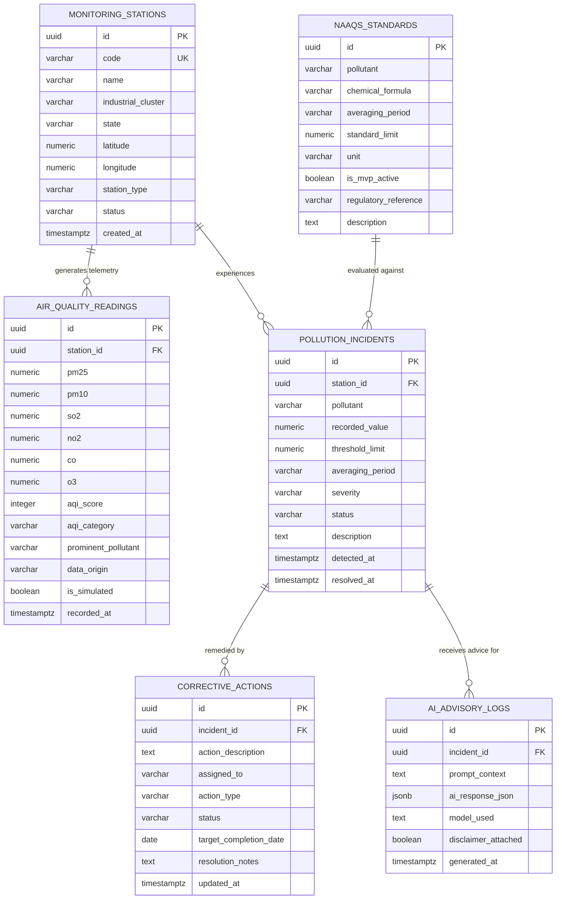

# EcoSentinel AI - Database Schema Specification

**Database Engine:** PostgreSQL (Supabase Managed Cloud)  
**Target Domain:** Ambient Air Quality & CPCB Regulatory Compliance  
**Schema Version:** 1.1.0 (Refined Hackathon Specification)  
**Official References:** CPCB NAAQS Notification (2009) & CPCB National AQI (2014)  

---

## 1. Entity-Relationship Diagram (ERD)



---

## 2. Table Specifications & DDL

### 2.1 `monitoring_stations`
Registry of industrial ambient air monitoring stations.

```sql
CREATE TABLE monitoring_stations (
    id UUID PRIMARY KEY DEFAULT gen_random_uuid(),
    code VARCHAR(50) UNIQUE NOT NULL,                      -- e.g. "STA-GJ-VAPI-01"
    name VARCHAR(255) NOT NULL,                            -- e.g. "Vapi GIDC Chemical Estate Station"
    industrial_cluster VARCHAR(255) NOT NULL,              -- e.g. "Vapi GIDC Phase II"
    state VARCHAR(100) NOT NULL,                           -- e.g. "Gujarat"
    latitude NUMERIC(9, 6) NOT NULL,                       -- e.g. 20.371600
    longitude NUMERIC(9, 6) NOT NULL,                      -- e.g. 72.910600
    station_type VARCHAR(50) DEFAULT 'INDUSTRIAL' CHECK (station_type IN ('INDUSTRIAL', 'RESIDENTIAL', 'ECOLOGICALLY_SENSITIVE')),
    status VARCHAR(50) DEFAULT 'ACTIVE' CHECK (status IN ('ACTIVE', 'MAINTENANCE', 'OFFLINE')),
    created_at TIMESTAMPTZ DEFAULT NOW()
);
```

---

### 2.2 `naaqs_standards`
Stores official statutory standards from CPCB NAAQS 2009. Includes both short-term (MVP active) and Annual standards (flagged for future scope).

```sql
CREATE TABLE naaqs_standards (
    id UUID PRIMARY KEY DEFAULT gen_random_uuid(),
    pollutant VARCHAR(50) NOT NULL,                        -- e.g. "PM2.5", "PM10", "SO2", "NO2", "CO", "O3"
    chemical_formula VARCHAR(20) NOT NULL,
    averaging_period VARCHAR(50) NOT NULL,                 -- "24 Hours", "8 Hours", "1 Hour", "Annual"
    standard_limit NUMERIC(10, 2) NOT NULL,                -- Statutory limit value
    unit VARCHAR(20) NOT NULL,                             -- "µg/m³", "mg/m³"
    is_mvp_active BOOLEAN DEFAULT TRUE NOT NULL,           -- True for 24h/8h/1h; False for Annual (future scope)
    regulatory_reference VARCHAR(255) NOT NULL,            -- "CPCB Notification B-29016/20/90/PCI-L (Nov 2009)"
    description TEXT,
    created_at TIMESTAMPTZ DEFAULT NOW(),
    CONSTRAINT uq_pollutant_period UNIQUE (pollutant, averaging_period)
);
```

---

### 2.3 `air_quality_readings`
Time-series environmental telemetry with explicit provenance tracking (`data_origin` and `is_simulated`).

```sql
CREATE TABLE air_quality_readings (
    id UUID PRIMARY KEY DEFAULT gen_random_uuid(),
    station_id UUID NOT NULL REFERENCES monitoring_stations(id) ON DELETE CASCADE,
    pm25 NUMERIC(8, 2) NOT NULL,                           -- µg/m³
    pm10 NUMERIC(8, 2) NOT NULL,                           -- µg/m³
    so2 NUMERIC(8, 2) NOT NULL,                            -- µg/m³
    no2 NUMERIC(8, 2) NOT NULL,                            -- µg/m³
    co NUMERIC(8, 2) NOT NULL,                             -- mg/m³
    o3 NUMERIC(8, 2) NOT NULL,                             -- µg/m³
    aqi_score INTEGER NOT NULL,                            -- Composite CPCB AQI (0 - 500)
    aqi_category VARCHAR(50) NOT NULL,                     -- "Good", "Satisfactory", "Moderate", "Poor", "Very Poor", "Severe"
    prominent_pollutant VARCHAR(50),                       -- Pollutant driving the max sub-index (e.g. "PM10")
    data_origin VARCHAR(50) DEFAULT 'SIMULATED' CHECK (data_origin IN ('SIMULATED', 'VERIFIED_MONITORING')),
    is_simulated BOOLEAN DEFAULT TRUE NOT NULL,            -- MANDATORY: TRUE for all demonstration streams
    recorded_at TIMESTAMPTZ DEFAULT NOW() NOT NULL
);

-- Compound index for fast dashboard telemetry and historical charting
CREATE INDEX idx_readings_station_recorded ON air_quality_readings (station_id, recorded_at DESC);
```

---

### 2.4 `pollution_incidents`
Tracks statutory non-compliance events when parameters breach CPCB NAAQS limits.

```sql
CREATE TABLE pollution_incidents (
    id UUID PRIMARY KEY DEFAULT gen_random_uuid(),
    station_id UUID NOT NULL REFERENCES monitoring_stations(id) ON DELETE CASCADE,
    pollutant VARCHAR(50) NOT NULL,                        -- e.g. "SO2", "PM2.5"
    recorded_value NUMERIC(10, 2) NOT NULL,                -- e.g. 94.50
    threshold_limit NUMERIC(10, 2) NOT NULL,               -- e.g. 80.00
    averaging_period VARCHAR(50) NOT NULL,                 -- e.g. "24 Hours", "8 Hours"
    severity VARCHAR(50) DEFAULT 'MODERATE' CHECK (severity IN ('LOW', 'MODERATE', 'HIGH', 'CRITICAL')),
    status VARCHAR(50) DEFAULT 'OPEN' CHECK (status IN ('OPEN', 'UNDER_REVIEW', 'ACTION_INITIATED', 'MITIGATED', 'CLOSED')),
    description TEXT,
    detected_at TIMESTAMPTZ DEFAULT NOW() NOT NULL,
    resolved_at TIMESTAMPTZ
);

CREATE INDEX idx_incidents_status ON pollution_incidents (status);
```

---

### 2.5 `corrective_actions`
Tracks remediation actions (CAPA) assigned to resolve incidents.

```sql
CREATE TABLE corrective_actions (
    id UUID PRIMARY KEY DEFAULT gen_random_uuid(),
    incident_id UUID NOT NULL REFERENCES pollution_incidents(id) ON DELETE CASCADE,
    action_description TEXT NOT NULL,
    assigned_to VARCHAR(150) NOT NULL,                     -- e.g. "S. Patel (Plant Utilities Lead)"
    action_type VARCHAR(100) DEFAULT 'OPERATIONAL' CHECK (action_type IN ('IMMEDIATE_ABATEMENT', 'OPERATIONAL', 'ENGINEERING_CONTROL', 'INSPECTION')),
    status VARCHAR(50) DEFAULT 'PENDING' CHECK (status IN ('PENDING', 'IN_PROGRESS', 'COMPLETED', 'VERIFIED')),
    target_completion_date DATE,
    resolution_notes TEXT,
    updated_at TIMESTAMPTZ DEFAULT NOW()
);
```

---

### 2.6 `ai_advisory_logs`
Audit log of all Gemini-generated root-cause analyses and mitigation advisory recommendations.

```sql
CREATE TABLE ai_advisory_logs (
    id UUID PRIMARY KEY DEFAULT gen_random_uuid(),
    incident_id UUID REFERENCES pollution_incidents(id) ON DELETE SET NULL,
    prompt_context TEXT NOT NULL,
    ai_response_json JSONB NOT NULL,                       -- Structured JSON from Gemini
    model_used VARCHAR(100) NOT NULL,                      -- e.g. "gemini-2.5-flash"
    disclaimer_attached BOOLEAN DEFAULT TRUE NOT NULL,     -- Confirms advisory disclaimer was served
    generated_at TIMESTAMPTZ DEFAULT NOW()
);
```

---

## 3. Seed Data Specification

### 3.1 Industrial Monitoring Stations
```sql
INSERT INTO monitoring_stations (code, name, industrial_cluster, state, latitude, longitude, station_type, status) VALUES
('STA-GJ-VAPI-01', 'Station Alpha - Chemical Processing Sector', 'Vapi GIDC Industrial Area', 'Gujarat', 20.371600, 72.910600, 'INDUSTRIAL', 'ACTIVE'),
('STA-HR-MANE-02', 'Station Beta - Auto Manufacturing Belt', 'Manesar IMT Sector 8', 'Haryana', 28.358800, 76.938800, 'INDUSTRIAL', 'ACTIVE'),
('STA-MH-TARA-03', 'Station Gamma - Textile & Heavy Engineering', 'Tarapur MIDC Zone B', 'Maharashtra', 19.825200, 72.693400, 'INDUSTRIAL', 'ACTIVE');
```

---

### 3.2 CPCB NAAQS 2009 Standards Schedule (Short-Term MVP vs Annual Future Scope)
```sql
INSERT INTO naaqs_standards (pollutant, chemical_formula, averaging_period, standard_limit, unit, is_mvp_active, regulatory_reference, description) VALUES
-- MVP Active Short-term Standards (24-hr, 8-hr, 1-hr)
('PM2.5', 'PM2.5', '24 Hours', 60.00, 'µg/m³', TRUE, 'CPCB Notification B-29016/20/90/PCI-L (2009)', 'Particulate Matter less than 2.5 microns (24h statutory limit)'),
('PM10', 'PM10', '24 Hours', 100.00, 'µg/m³', TRUE, 'CPCB Notification B-29016/20/90/PCI-L (2009)', 'Particulate Matter less than 10 microns (24h statutory limit)'),
('SO2', 'SO2', '24 Hours', 80.00, 'µg/m³', TRUE, 'CPCB Notification B-29016/20/90/PCI-L (2009)', 'Sulphur Dioxide 24h statutory limit (Industrial/Residential)'),
('NO2', 'NO2', '24 Hours', 80.00, 'µg/m³', TRUE, 'CPCB Notification B-29016/20/90/PCI-L (2009)', 'Nitrogen Dioxide 24h statutory limit (Industrial/Residential)'),
('CO', 'CO', '8 Hours', 2.00, 'mg/m³', TRUE, 'CPCB Notification B-29016/20/90/PCI-L (2009)', 'Carbon Monoxide 8-hour non-dispersive infrared standard'),
('CO', 'CO', '1 Hour', 4.00, 'mg/m³', TRUE, 'CPCB Notification B-29016/20/90/PCI-L (2009)', 'Carbon Monoxide 1-hour short-term exposure standard'),
('O3', 'O3', '8 Hours', 100.00, 'µg/m³', TRUE, 'CPCB Notification B-29016/20/90/PCI-L (2009)', 'Ozone 8-hour photochemical standard'),
('O3', 'O3', '1 Hour', 180.00, 'µg/m³', TRUE, 'CPCB Notification B-29016/20/90/PCI-L (2009)', 'Ozone 1-hour peak photochemical standard'),

-- Future Scope Annual Standards (Requires >=104 measurements/year)
('PM2.5', 'PM2.5', 'Annual', 40.00, 'µg/m³', FALSE, 'CPCB Notification B-29016/20/90/PCI-L (2009)', 'Annual arithmetic mean of minimum 104 measurements in a year'),
('PM10', 'PM10', 'Annual', 60.00, 'µg/m³', FALSE, 'CPCB Notification B-29016/20/90/PCI-L (2009)', 'Annual arithmetic mean of minimum 104 measurements in a year'),
('SO2', 'SO2', 'Annual', 50.00, 'µg/m³', FALSE, 'CPCB Notification B-29016/20/90/PCI-L (2009)', 'Annual arithmetic mean of minimum 104 measurements in a year'),
('NO2', 'NO2', 'Annual', 40.00, 'µg/m³', FALSE, 'CPCB Notification B-29016/20/90/PCI-L (2009)', 'Annual arithmetic mean of minimum 104 measurements in a year');
```

---

### 3.3 Sample Air Quality Reading (Explicitly Simulated)
```sql
INSERT INTO air_quality_readings (
    station_id,
    pm25, pm10, so2, no2, co, o3,
    aqi_score, aqi_category, prominent_pollutant,
    data_origin, is_simulated,
    recorded_at
) VALUES (
    (SELECT id FROM monitoring_stations WHERE code = 'STA-GJ-VAPI-01'),
    58.40,          -- PM2.5 in µg/m³ (24h limit: 60)
    118.20,         -- PM10 in µg/m³ (24h limit: 100 - BREACH)
    94.50,          -- SO2 in µg/m³ (24h limit: 80 - BREACH)
    62.10,          -- NO2 in µg/m³ (24h limit: 80)
    1.40,           -- CO in mg/m³ (8h limit: 2.0)
    42.00,          -- O3 in µg/m³ (8h limit: 100)
    215,            -- Composite CPCB AQI
    'Poor',         -- CPCB AQI Category
    'SO2',          -- Prominent pollutant driving sub-index
    'SIMULATED',    -- Explicit data provenance
    TRUE,           -- Boolean simulated indicator
    NOW()
);
```

---

### 3.4 Sample Pollution Incident Record
```sql
INSERT INTO pollution_incidents (
    station_id,
    pollutant,
    recorded_value,
    threshold_limit,
    averaging_period,
    severity,
    status,
    description,
    detected_at
) VALUES (
    (SELECT id FROM monitoring_stations WHERE code = 'STA-GJ-VAPI-01'),
    'SO2',
    94.50,
    80.00,
    '24 Hours',
    'HIGH',
    'OPEN',
    'Rolling 24-hour average SO2 concentration reached 94.50 µg/m³, breaching the CPCB statutory NAAQS limit of 80 µg/m³.',
    NOW()
);
```

---

### 3.5 Sample Corrective Action Record (CAPA)
```sql
INSERT INTO corrective_actions (
    incident_id,
    action_description,
    assigned_to,
    action_type,
    status,
    target_completion_date,
    resolution_notes
) VALUES (
    (SELECT id FROM pollution_incidents WHERE pollutant = 'SO2' AND status = 'OPEN' LIMIT 1),
    'Inspect wet limestone scrubber liquor pH, verify alkali circulation pump pressure, and check boiler fuel-oil sulphur batch certificate.',
    'S. Patel (Plant Utilities Lead)',
    'IMMEDIATE_ABATEMENT',
    'IN_PROGRESS',
    CURRENT_DATE + INTERVAL '1 day',
    'Caustic dosing pump inspected; dosing rate increased to restore liquor pH from 5.4 to 8.2.'
);
```

---

### 3.6 Sample AI Advisory Log Record
```sql
INSERT INTO ai_advisory_logs (
    incident_id,
    prompt_context,
    ai_response_json,
    model_used,
    disclaimer_attached,
    generated_at
) VALUES (
    (SELECT id FROM pollution_incidents WHERE pollutant = 'SO2' LIMIT 1),
    'Station: Vapi GIDC Chemical Cluster | Pollutant: SO2 | Value: 94.50 µg/m³ | Standard: 80.00 µg/m³ (24 Hours)',
    '{
        "probable_root_causes": [
            "Flue gas desulphurization (FGD) scrubber caustic dosing pump failure or liquor acidification below pH 6.0",
            "High-sulphur furnace oil batch utilized in auxiliary steam boiler"
        ],
        "immediate_mitigation_steps": [
            "Increase caustic soda (NaOH) slurry dosing rate to maintain scrubbing pH between 8.0 and 8.5",
            "Curtail boiler firing rate by 20% until scrubber differential pressure and outlet SO2 stabilize"
        ],
        "long_term_capa": [
            "Install automated pH-controlled dosing solenoid valve and redundant recirculating pump",
            "Mandate certified fuel oil delivery reports ensuring sulphur content <= 1.5% wt"
        ],
        "cpcb_reference": "CPCB Environmental Standards for Industrial Boilers and Smelters",
        "disclaimer": "ADVISORY NOTICE: Recommendations provided by EcoSentinel AI are technical and operational suggestions for internal decision-support. They do not constitute official statutory compliance determinations or certified legal clearance under Central or State Pollution Control Board regulations."
    }'::jsonb,
    'gemini-2.5-flash',
    TRUE,
    NOW()
);
```
