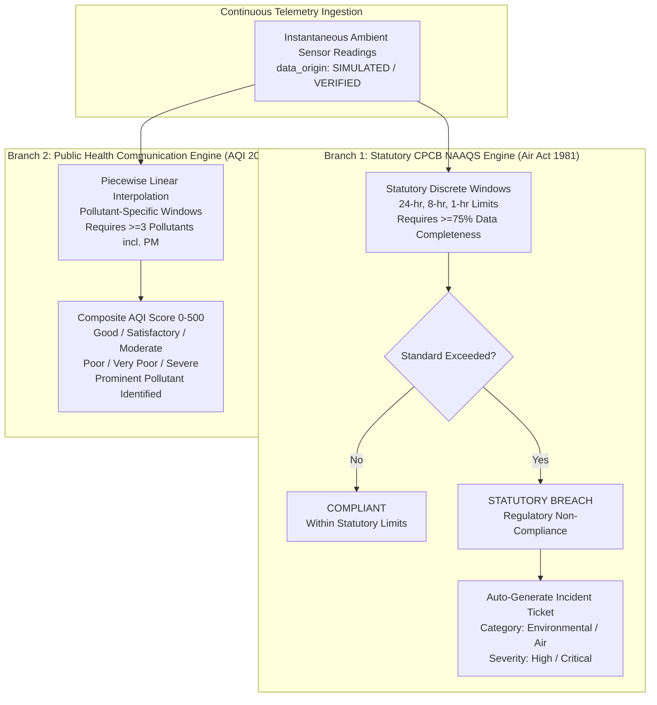
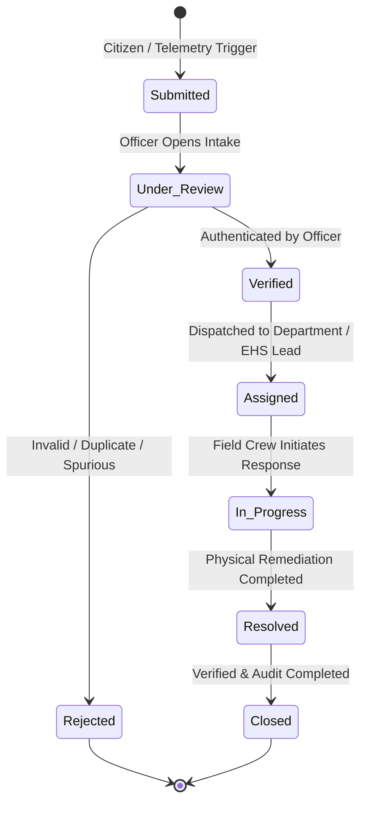

# EcoSentinel AI - Detailed Requirements Document (DRD)

**Project Name:** EcoSentinel AI  
**Scope:** Functional & Non-Functional Specifications for Unified Environmental & Incident Intelligence Platform  
**Target Milestone:** Hackathon MVP (Single Developer Track)  
**Regulatory & Official References:**
* **CPCB NAAQS Notification (2009):** Gazette of India No. B-29016/20/90/PCI-L ([CPCB Air Quality Standards](https://cpcb.nic.in/air-quality-standards/))
* **CPCB National Air Quality Index Technical Manual (2014):** MoEF&CC / CPCB ([CPCB National AQI Report](https://cpcb.nic.in/National-Air-Quality-Index/))
* **The Air (Prevention and Control of Pollution) Act, 1981:** ([CPCB Acts & Rules](https://cpcb.nic.in))
* **The Disaster Management Act, 2005:** National Disaster Management Authority Guidelines ([NDMA Portal](https://ndma.gov.in/))

---

## 1. CPCB Regulatory Framework: Statutory NAAQS vs. Public AQI

A foundational architectural requirement of EcoSentinel AI is the absolute clarity and strict programmatic separation between **Statutory NAAQS Compliance** and the **National Air Quality Index (AQI)**.



---

### 1.1 CPCB NAAQS Standards (Industrial, Residential, Rural & Other Areas)
*Gazette of India, Extraordinary, Notification No. B-29016/20/90/PCI-L, November 18, 2009.*

| Pollutant | Chemical Symbol | Averaging Period | CPCB Limit | Unit | Scope in EcoSentinel AI |
| :--- | :--- | :--- | :--- | :--- | :--- |
| **$\text{PM}_{2.5}$** | Fine Particulate Matter ($<2.5\,\mu\text{m}$) | **24 Hours** | **$60$** | $\mu\text{g}/\text{m}^3$ | **In-Scope (MVP)** |
| $\text{PM}_{2.5}$ | Fine Particulate Matter ($<2.5\,\mu\text{m}$) | Annual | $40$ | $\mu\text{g}/\text{m}^3$ | *Future Scope (Requires $\ge 104$ measurements/yr)* |
| **$\text{PM}_{10}$** | Respirable Particulate Matter ($<10\,\mu\text{m}$) | **24 Hours** | **$100$** | $\mu\text{g}/\text{m}^3$ | **In-Scope (MVP)** |
| $\text{PM}_{10}$ | Respirable Particulate Matter ($<10\,\mu\text{m}$) | Annual | $60$ | $\mu\text{g}/\text{m}^3$ | *Future Scope (Requires $\ge 104$ measurements/yr)* |
| **$\text{SO}_2$** | Sulphur Dioxide | **24 Hours** | **$80$** | $\mu\text{g}/\text{m}^3$ | **In-Scope (MVP)** |
| $\text{SO}_2$ | Sulphur Dioxide | Annual | $50$ | $\mu\text{g}/\text{m}^3$ | *Future Scope (Requires $\ge 104$ measurements/yr)* |
| **$\text{NO}_2$** | Nitrogen Dioxide | **24 Hours** | **$80$** | $\mu\text{g}/\text{m}^3$ | **In-Scope (MVP)** |
| $\text{NO}_2$ | Nitrogen Dioxide | Annual | $40$ | $\mu\text{g}/\text{m}^3$ | *Future Scope (Requires $\ge 104$ measurements/yr)* |
| **$\text{CO}$** | Carbon Monoxide | **8 Hours** | **$2.0$** ($2000\,\mu\text{g}/\text{m}^3$) | $\text{mg}/\text{m}^3$ | **In-Scope (MVP)** |
| **$\text{CO}$** | Carbon Monoxide | **1 Hour** | **$4.0$** ($4000\,\mu\text{g}/\text{m}^3$) | $\text{mg}/\text{m}^3$ | **In-Scope (MVP)** |
| **$\text{O}_3$** | Ground-level Ozone | **8 Hours** | **$100$** | $\mu\text{g}/\text{m}^3$ | **In-Scope (MVP)** |
| **$\text{O}_3$** | Ground-level Ozone | **1 Hour** | **$180$** | $\mu\text{g}/\text{m}^3$ | **In-Scope (MVP)** |
| $\text{NH}_3$ | Ammonia | 24 Hours / Annual | $400$ / $100$ | $\mu\text{g}/\text{m}^3$ | *Future Scope* |
| $\text{Pb}$ | Lead | 24 Hours / Annual | $1.0$ / $0.50$ | $\mu\text{g}/\text{m}^3$ | *Future Scope* |
| $\text{Ni}, \text{As}, \text{Benzene}, \text{BaP}$ | Toxic organics & heavy metals | Annual | Varies | $\text{ng}/\text{m}^3$, $\mu\text{g}/\text{m}^3$ | *Future Scope* |

> [!NOTE]
> **Ecologically Sensitive Areas:** CPCB specifies stricter standards for ecologically sensitive areas declared by the Central Government (e.g., Annual $\text{SO}_2$ is $20\,\mu\text{g}/\text{m}^3$, $\text{NO}_2$ is $30\,\mu\text{g}/\text{m}^3$). For the MVP, the system implements the Industrial, Residential, Rural and other Areas schedule, with sensitive zones configurable via station metadata.

---

### 1.2 Averaging Methodology & Data Capture Requirements

The platform strictly differentiates between two computational averaging models:
1. **Statutory Discrete Averaging (Regulatory Assessment):**
   * Evaluated over discrete non-overlapping calendar intervals (e.g., calendar day 00:00 to 23:59 for 24-hr standards, 8-hour blocks, and 1-hour hourly means).
   * **75% Data Completeness Requirement:** In adherence to CPCB monitoring guidelines, a statutory average is legally valid only if at least **$75\%$ valid observations** are recorded (e.g., at least 18 valid hourly readings in a 24-hour cycle). If valid observations fall below $75\%$, the assessment status is flagged as `INSUFFICIENT_DATA_CAPTURE` rather than marking compliant.
2. **Operational Rolling Averaging (Engineering Early Warning):**
   * Evaluated continuously on sliding temporal windows (trailing 24 hours for $\text{PM}$ and toxic gases; trailing 8 hours for $\text{CO}$ and $\text{O}_3$).
   * Displayed on real-time dashboard dials and predictive trend modules to alert operators well before a discrete calendar window is compromised.

---

### 1.3 CPCB National Air Quality Index (AQI) Calculation Methodology
*Reference: CPCB National Air Quality Index Report, October 2014.*

The composite AQI converts concentrations into a single dimensionless index using piecewise linear interpolation for each pollutant $i$:
$$I_i = \frac{I_{\text{high}} - I_{\text{low}}}{B_{\text{high}} - B_{\text{low}}} \cdot (C_i - B_{\text{low}}) + I_{\text{low}}$$
where $C_i$ is the concentration averaged over the pollutant's required AQI averaging window, $[B_{\text{low}}, B_{\text{high}}]$ are concentration breakpoints, and $[I_{\text{low}}, I_{\text{high}}]$ are sub-index breakpoints.

#### CPCB AQI Breakpoints Matrix
| AQI Category | AQI Range | $\text{PM}_{2.5}$ (24h) | $\text{PM}_{10}$ (24h) | $\text{NO}_2$ (24h) | $\text{SO}_2$ (24h) | $\text{CO}$ (8h, mg/m³) | $\text{O}_3$ (8h) |
| :--- | :---: | :---: | :---: | :---: | :---: | :---: | :---: |
| **Good** | $0 - 50$ | $0 - 30$ | $0 - 50$ | $0 - 40$ | $0 - 40$ | $0.0 - 1.0$ | $0 - 50$ |
| **Satisfactory** | $51 - 100$ | $31 - 60$ | $51 - 100$ | $41 - 80$ | $41 - 80$ | $1.1 - 2.0$ | $51 - 100$ |
| **Moderate** | $101 - 200$ | $61 - 90$ | $101 - 250$ | $81 - 180$ | $81 - 380$ | $2.1 - 10.0$ | $101 - 168$ |
| **Poor** | $201 - 300$ | $91 - 120$ | $251 - 350$ | $181 - 280$ | $381 - 800$ | $10.1 - 17.0$ | $169 - 208$ |
| **Very Poor** | $301 - 400$ | $121 - 250$ | $351 - 430$ | $281 - 400$ | $801 - 1600$ | $17.1 - 34.0$ | $209 - 748$ |
| **Severe** | $401 - 500$ | $250+$ | $430+$ | $400+$ | $1600+$ | $34.0+$ | $748+$ |

#### CPCB Composite AQI Mandatory Rules:
* **Minimum Requirement:** The composite AQI can only be calculated if at least **3 pollutants** are monitored, and at least **one of them MUST be $\text{PM}_{2.5}$ or $\text{PM}_{10}$**.
* **Formula:** $\text{Composite AQI} = \max(I_{\text{PM}2.5}, I_{\text{PM}10}, I_{\text{SO}2}, I_{\text{NO}2}, I_{\text{CO}}, I_{\text{O}3})$.
* The pollutant responsible for the highest sub-index is identified as the **Prominent Pollutant**.

---

## 2. Multi-Domain Incident Taxonomy & Requirements

EcoSentinel AI standardizes incident intake and triage across four major domains:

```text
1. ENVIRONMENTAL POLLUTION
   ├── Air Pollution (Telemetry Breaches & Industrial Flaring)
   ├── Water Pollution (Chemical Effluent, River Contamination)
   ├── Hazardous Waste Dumping & Toxic Residues
   ├── Soil Contamination & Illegal Industrial Burial
   └── Noise Pollution Violations (Silent & Residential Zones)

2. NATURAL DISASTERS
   ├── Urban Flooding & Severe Waterlogging
   ├── Earthquakes & Seismic Structural Damage
   ├── Landslides & Debris Slips in Hilly Transit Arteries
   ├── Cyclones & Extreme Gale Force Storms
   └── Heatwaves, Wildfires & Extended Drought Conditions

3. ACCIDENTS & EMERGENCIES
   ├── Industrial Explosions, Boiler Failures & Factory Fires
   ├── Hazardous Gas Releases (Ammonia, Chlorine, VOCs)
   ├── Major Highway, Commercial & Road Collisions
   ├── Structural Collapse (Bridges, Commercial Buildings)
   └── Electrical Grid Faults, Transformer Fires & Exposed Cables

4. PUBLIC INFRASTRUCTURE
   ├── Roadway Sinkholes, Potholes & Structural Fractures
   ├── Broken Stormwater Drains & Overflowing Manholes
   ├── Raw Sewage Surges & Treatment Plant Blockages
   ├── Fallen Trees Obstructing Arterial Roads
   └── Municipal Drinking Water Pipe Bursts & Quality Disruptions
```

---

## 3. Incident Lifecycle & State Machine

Every incident logged in EcoSentinel AI follows a strict 7-stage lifecycle with human verification:



### 3.1 State Definitions
1. **`Submitted`:** Incident recorded via citizen intake or telemetry auto-generation. Evidence attached. Awaiting human review.
2. **`Under Review`:** Designated officer or dispatcher is actively reviewing location, descriptions, and uploaded photographic evidence.
3. **`Verified`:** Officer confirms the incident is genuine, authentic, and non-duplicate. Severity rating adjusted if needed.
4. **`Assigned`:** Incident formally routed to a responsible responding agency (e.g. *Fire Department*, *Municipal Works*, *State PCB*, *Industrial EHS Team*).
5. **`In Progress`:** Assigned team has acknowledged the ticket, arrived on site, and begun active mitigation/remediation.
6. **`Resolved`:** Containment or repair complete. Field notes, resolution evidence, and root-cause summaries recorded.
7. **`Closed`:** Senior auditor or municipal dispatcher inspects resolution, validates air/environmental normalization or road clearance, and archives ticket.
8. **`Rejected` (Terminal Branch):** Ticket identified as spam, out of jurisdiction, erroneous, or duplicate. Reason required.

### 3.2 Severity Classification Matrix
* **`Low`:** Localized nuisance or non-urgent infrastructure defect (e.g., small pothole, minor littering, sub-statutory sensor drift).
* **`Moderate`:** Notable disruption or approaching statutory threshold (e.g., broken stormwater grate, sewer overflow, AQI Poor).
* **`High`:** Direct statutory breach, public danger, or major disruption (e.g., NAAQS 24-hr exceedance, chemical effluent leak, structural wall crack).
* **`Critical`:** Immediate threat to human life, large-scale industrial catastrophe, or severe disaster (e.g., toxic gas cloud, major factory fire, urban flash flood).

---

## 4. Functional Specifications (FR)

### FR-1: Unified Multi-Category Incident Ingestion
* **FR-1.1 (Category & Type Hierarchy):** The intake form must dynamically render subtype selections based on the selected parent category.
* **FR-1.2 (Location Specification):** User can enter coordinates manually, click on an interactive Leaflet map to drop a pin, or choose from registered industrial/urban preset locations.
* **FR-1.3 (Simulated Evidence Attachment):** Support image/document attachments (simulated upload in MVP with preview, file size validation $<5\,\text{MB}$, and MIME type restrictions: JPEG, PNG, PDF).
* **FR-1.4 (Automated Incident ID Generation):** Every submitted incident receives a deterministic, human-readable code: `INC-YYYY-XXXXX`.

### FR-2: Ambient Air Telemetry & Provenance
* **FR-2.1 (Data Origin Tagging):** Every telemetry reading must carry explicit provenance:
  * `data_origin = 'SIMULATED'` and `is_simulated = true` for synthetic streams.
  * `data_origin = 'VERIFIED_MONITORING'` and `is_simulated = false` for physical CAAQMS stations.
* **FR-2.2 (UI Visual Provenance Badging):** Prominent `[SIMULATED DATA]` tag rendered on all dashboard cards, charts, and table rows during demo execution.
* **FR-2.3 (Station Registry):** 3 preset monitoring locations with accurate GPS coordinates:
  1. *Station Alpha:* Vapi GIDC Chemical Industrial Estate, Gujarat (`STA-GJ-VAPI-01`).
  2. *Station Beta:* Manesar IMT Automotive Industrial Belt, Haryana (`STA-HR-MANE-02`).
  3. *Station Gamma:* Tarapur MIDC Heavy Engineering Zone, Maharashtra (`STA-MH-TARA-03`).

### FR-3: CPCB Compliance & Automated Breach Engine
* **FR-3.1 (Statutory Limit Checks):** Backend evaluates active rolling and discrete averages against the 2009 Gazette standards:
  * $\text{PM}_{2.5}$ ($60\,\mu\text{g}/\text{m}^3$), $\text{PM}_{10}$ ($100\,\mu\text{g}/\text{m}^3$), $\text{SO}_2$ ($80\,\mu\text{g}/\text{m}^3$), $\text{NO}_2$ ($80\,\mu\text{g}/\text{m}^3$).
  * $\text{CO}$ ($8\text{-hr}: 2.0\,\text{mg}/\text{m}^3$, $1\text{-hr}: 4.0\,\text{mg}/\text{m}^3$).
  * $\text{O}_3$ ($8\text{-hr}: 100\,\mu\text{g}/\text{m}^3$, $1\text{-hr}: 180\,\mu\text{g}/\text{m}^3$).
* **FR-3.2 (Automated Breach Escalation):** When a statutory limit is breached under $\ge 75\%$ data capture, the system auto-creates an incident ticket under Category *Environmental*, Type *Air Pollution*, Severity *High* or *Critical*.
* **FR-3.3 (Deduplication):** Prevents duplicate incident generation for the same station and pollutant if an unresolved ticket was logged within the preceding 4 hours.

### FR-4: Environmental Intelligence & Operational Anomaly Heuristics
* **FR-4.1 (Internal Demonstration Surge Heuristic):**
  > [!IMPORTANT]
  > **Internal Demonstration Anomaly Heuristic (Not a CPCB Rule):**  
  > If an instantaneous reading exhibits an increase of $\ge 40\%$ within a 15-minute window relative to the preceding 1-hour baseline, the system flags an `OPERATIONAL SURGE ANOMALY`.  
  > *Documentation Note:* This $40\%$ threshold is explicitly defined as an internal EcoSentinel engineering heuristic for early industrial leak detection and demonstration purposes, NOT an official CPCB regulatory standard.
* **FR-4.2 (Sensor Health Diagnostic):** If 10 consecutive telemetry intervals report identical values (variance $= 0.000$), flag sensor health as `FROZEN/DEGRADED`.
* **FR-4.3 (Trend Forecasting & Time-to-Breach):**
  * Evaluates linear slope over the preceding 6–12 hours using ordinary least squares (OLS).
  * Calculates estimated time-to-breach:
    $$T_{\text{breach}} = \frac{\text{NAAQS Limit} - \text{Current Value}}{\text{Hourly Rate of Change}}$$
  * Triggers advance warning alert if $T_{\text{breach}} \le 4\,\text{hours}$.

### FR-5: Interactive Geospatial Mapping
* **FR-5.1 (Leaflet Map Engine):** Interactive OpenStreetMap integration with smooth zooming, panning, and responsive full-width display.
* **FR-5.2 (Dual Layer Plotting):**
  * Layer A: Continuous Monitoring Stations (circular pulsing markers color-coded by AQI category).
  * Layer B: Multi-category Incidents (custom iconography color-coded by severity: Low/Amber, Moderate/Orange, High/Red, Critical/Purple).
* **FR-5.3 (Interactive Popups & Filtering):**
  * Station popup: Station name, city, current AQI, prominent pollutant, PM2.5/PM10 concentrations, compliance badge, and timestamp.
  * Incident popup: Incident code, category, severity, status, address, description, and link to manage ticket.
  * Filter controls: Filter by Category (Environmental, Disaster, Emergency, Infrastructure) and Severity (All, Critical, High, Moderate, Low).

### FR-6: Gemini AI Incident Intelligence & Safety Boundaries
* **FR-6.1 (Contextual Prompt Assembly):** System packages incident details (category, subtype, severity, location, telemetry, sensor surge data) into a structured prompt.
* **FR-6.2 (Structured Advisory Response):** Gemini API generates a structured JSON payload:
  * `risk_assessment`: Objective assessment of public health or safety risk.
  * `immediate_actions`: Prioritized 3-step immediate safety containment procedures.
  * `recommended_resources`: Suggested response units (e.g. Foam tender fire unit, Hazmat neutralization team, Vacuum sewer tanker).
  * `preventive_capa`: Long-term engineering or civic remediation actions.
* **FR-6.3 (Strict AI Safety Boundaries & Disclaimers):**
  * **Human-in-the-Loop Mandate:** Gemini outputs are strictly advisory decision-support recommendations. They **cannot** automatically dispatch emergency crews, issue binding evacuation orders, or alter statutory compliance determinations without explicit human authorization.
  * **Mandatory Advisory Disclaimer:**
    > *"ADVISORY NOTICE: Recommendations generated by EcoSentinel AI Copilot are technical and operational suggestions for decision-support. They do not constitute official statutory compliance determinations, legal certifications, or government emergency dispatch orders."*

### FR-7: Incident Management & CAPA Audit Trail
* **FR-7.1 (Ticket Filtering & Search):** Filter tickets by status, category, severity, date range, or free-text search across descriptions and locations.
* **FR-7.2 (Lifecycle State Transitions):** Authorized users can advance ticket states with mandatory transitional comments.
* **FR-7.3 (Corrective and Preventive Action Tracking):** Link formal CAPA entries to incidents with target completion dates, assigned personnel, action types, and resolution sign-offs.
* **FR-7.4 (Chronological Audit History):** Track all status modifications, assignments, and AI advisory logs in relational audit records.

---

## 5. Non-Functional Requirements (NFR)

* **NFR-1 (Single-Developer Maintainability):**
  * Clean monolithic full-stack architecture: React 19 + Express.js + Supabase PostgreSQL + Google Gemini API.
  * No external microservice orchestration or heavy queue dependencies (e.g. Kafka/RabbitMQ) for MVP.
* **NFR-2 (Performance & Latency):**
  * Telemetry and incident list REST API responses $< 250\,\text{ms}$.
  * Leaflet map rendering $< 400\,\text{ms}$ with up to 100 markers.
  * Gemini AI advisory response $< 4.0\,\text{seconds}$.
* **NFR-3 (Visual Aesthetics & Responsive UI):**
  * **Minimal Premium** design language: `#174B35` (Deep Forest Green), `#A8BFAE` (Sage Green), `#EAF1EB` (Light Sage), `#F7F9F7` (Background), `#202923` (Charcoal Text).
  * Fully responsive across mobile ($375\text{px}+$ viewport) and desktop ($1440\text{px}+$ viewport).
* **NFR-4 (Security & Credential Isolation):**
  * All cloud secrets (`GEMINI_API_KEY`, `SUPABASE_SERVICE_ROLE_KEY`) stored exclusively in server-side `.env`.
  * No secrets or administrative keys bundled into client-side Vite builds.
* **NFR-5 (Data Integrity & Transparent Simulation):**
  * All synthetic or demo records clearly tagged with `is_simulated = true` at the database level and visually marked on the client.
