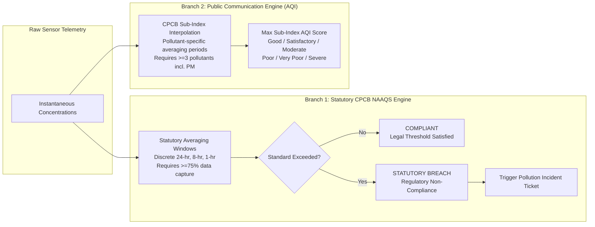

# EcoSentinel AI - Detailed Requirements Document (DRD)

**Project Name:** EcoSentinel AI  
**Scope:** Functional & Non-Functional Specifications for Hackathon MVP  
**Regulatory References:**
* **CPCB NAAQS Notification (2009):** Gazette of India No. B-29016/20/90/PCI-L ([CPCB Air Quality Standards](https://cpcb.nic.in/air-quality-standards/))
* **CPCB National Air Quality Index Technical Manual (2014):** MoEF&CC / CPCB ([CPCB National AQI Report](https://cpcb.nic.in/National-Air-Quality-Index/))
* **The Air (Prevention and Control of Pollution) Act, 1981:** ([CPCB Acts & Rules](https://cpcb.nic.in))

---

## 1. CPCB Regulatory Framework: NAAQS vs. AQI

A core architectural principle of EcoSentinel AI is the absolute clarity and strict programmatic distinction between **Statutory NAAQS Compliance** and the **National Air Quality Index (AQI)**.

---

### 1.1 CPCB NAAQS Standards (Industrial, Residential, Rural & Other Areas)
*Gazette of India, Extraordinary, Notification No. B-29016/20/90/PCI-L, November 18, 2009.*

| Pollutant | Chemical Symbol | Averaging Period | CPCB Limit | Unit | Scope in EcoSentinel AI |
| :--- | :--- | :--- | :--- | :--- | :--- |
| **$\text{PM}_{2.5}$** | Particulate Matter ($<2.5\,\mu\text{m}$) | **24 Hours** | **$60$** | $\mu\text{g}/\text{m}^3$ | **In-Scope (MVP)** |
| $\text{PM}_{2.5}$ | Particulate Matter ($<2.5\,\mu\text{m}$) | Annual | $40$ | $\mu\text{g}/\text{m}^3$ | *Future Scope (Requires $\ge 104$ measurements/yr)* |
| **$\text{PM}_{10}$** | Respirable Particulate Matter ($<10\,\mu\text{m}$) | **24 Hours** | **$100$** | $\mu\text{g}/\text{m}^3$ | **In-Scope (MVP)** |
| $\text{PM}_{10}$ | Respirable Particulate Matter ($<10\,\mu\text{m}$) | Annual | $60$ | $\mu\text{g}/\text{m}^3$ | *Future Scope (Requires $\ge 104$ measurements/yr)* |
| **$\text{SO}_2$** | Sulphur Dioxide | **24 Hours** | **$80$** | $\mu\text{g}/\text{m}^3$ | **In-Scope (MVP)** |
| $\text{SO}_2$ | Sulphur Dioxide | Annual | $50$ | $\mu\text{g}/\text{m}^3$ | *Future Scope (Requires $\ge 104$ measurements/yr)* |
| **$\text{NO}_2$** | Nitrogen Dioxide | **24 Hours** | **$80$** | $\mu\text{g}/\text{m}^3$ | **In-Scope (MVP)** |
| $\text{NO}_2$ | Nitrogen Dioxide | Annual | $40$ | $\mu\text{g}/\text{m}^3$ | *Future Scope (Requires $\ge 104$ measurements/yr)* |
| **$\text{CO}$** | Carbon Monoxide | **8 Hours** | **$2.0$** ($2000\,\mu\text{g}/\text{m}^3$) | $\text{mg}/\text{m}^3$ | **In-Scope (MVP)** |
| **$\text{CO}$** | Carbon Monoxide | **1 Hour** | **$4.0$** ($4000\,\mu\text{g}/\text{m}^3$) | $\text{mg}/\text{m}^3$ | **In-Scope (MVP)** |
| **$\text{O}_3$** | Ground-level Ozone | **8 Hours** | **$100$** | $\mu\text{g}/\text{m}^3$ | **In-Scope (MVP)** |
| **$\text{O}_3$** | Ground-level Ozone | **1 Hour** | **$180$** | $\mu\text{g}/\text{m}^3$ | **In-Scope (MVP)** |
| $\text{NH}_3$ | Ammonia | 24 Hours / Annual | $400$ / $100$ | $\mu\text{g}/\text{m}^3$ | *Future Scope* |
| $\text{Pb}$ | Lead | 24 Hours / Annual | $1.0$ / $0.50$ | $\mu\text{g}/\text{m}^3$ | *Future Scope* |
| $\text{Ni}, \text{As}, \text{Benzene}, \text{BaP}$ | Toxic organics & heavy metals | Annual | Varies | $\text{ng}/\text{m}^3$, $\mu\text{g}/\text{m}^3$ | *Future Scope* |

> [!NOTE]
> **Ecologically Sensitive Areas:** CPCB specifies tighter standards for ecologically sensitive areas declared by the Central Government (e.g., Annual $\text{SO}_2$ is $20\,\mu\text{g}/\text{m}^3$, $\text{NO}_2$ is $30\,\mu\text{g}/\text{m}^3$). For the MVP, we default to the Industrial/Residential/Rural schedule, with sensitive zones earmarked for future configuration.

---

### 1.2 Averaging Methodology & Data Capture Requirements

The platform distinguishes between two types of averages:

1. **Statutory Averaging (Official Regulatory Standard):**
   * Computed over a discrete calendar/monitoring period (e.g., 24-hour block from 00:00 to 23:59 or continuous 24-hour sampling).
   * **Data Completeness Requirement:** In accordance with standard CPCB guidelines, a valid 24-hour average requires **minimum $75\%$ data capture** (at least 18 valid hourly observations out of 24, or 16 hours in continuous monitoring protocols). If data capture is $<75\%$, the calculation is marked as `INSUFFICIENT_DATA_CAPTURE` rather than confirming compliance.
2. **Operational Rolling Average (Real-time Engineering Monitor):**
   * Computed on a continuous sliding window (e.g., trailing 24 hours for $\text{PM}_{2.5}$, trailing 8 hours for $\text{CO}$).
   * Used for real-time dashboard gauges and early-warning trend alerts to give operators advance notice before a discrete statutory block is breached.

---

### 1.3 CPCB National Air Quality Index (AQI) Calculation Methodology
*Reference: CPCB National Air Quality Index Report, October 2014.*

The composite AQI converts concentrations into a single dimensional index using piecewise linear interpolation for each pollutant $i$:
$$I_i = \frac{I_{\text{high}} - I_{\text{low}}}{B_{\text{high}} - B_{\text{low}}} \cdot (C_i - B_{\text{low}}) + I_{\text{low}}$$
where $C_i$ is the concentration averaged over the pollutant's required AQI averaging window, $[B_{\text{low}}, B_{\text{high}}]$ are concentration breakpoints, and $[I_{\text{low}}, I_{\text{high}}]$ are sub-index breakpoints.

#### CPCB AQI Breakpoints Matrix
| AQI Category | AQI Range | $\text{PM}_{2.5}$ (24h) | $\text{PM}_{10}$ (24h) | $\text{NO}_2$ (24h) | $\text{SO}_2$ (24h) | $\text{CO}$ (8h, mg/m³) | $\text{O}_3$ (8h) |
| :--- | :---: | :---: | :---: | :---: | :---: | :---: | :---: |
| **Good** | $0 - 50$ | $0 - 30$ | $0 - 50$ | $0 - 40$ | $0 - 40$ | $0.0 - 1.0$ | $0 - 50$ |
| **Satisfactory** | $51 - 100$ | $31 - 60$ | $51 - 100$ | $41 - 80$ | $41 - 80$ | $1.1 - 2.0$ | $51 - 100$ |
| **Moderate** | $101 - 200$ | $61 - 90$ | $101 - 250$ | $81 - 180$ | $81 - 380$ | $2.1 - 10.0$ | $101 - 168$ |
| **Poor** | $201 - 300$ | $91 - 120$ | $251 - 350$ | $181 - 280$ | $381 - 800$ | $10.1 - 17.0$ | $169 - 208$ |
| **Very Poor** | $301 - 400$ | $121 - 250$ | $351 - 430$ | $281 - 400$ | $801 - 1600$ | $17.1 - 34.0$ | $209 - 748$ |
| **Severe** | $401 - 500$ | $250+$ | $430+$ | $400+$ | $1600+$ | $34.0+$ | $748+$ |

#### CPCB Composite AQI Rule:
* **Minimum Requirement:** The composite AQI can only be calculated if at least **3 pollutants** are monitored, and at least **one of them MUST be $\text{PM}_{2.5}$ or $\text{PM}_{10}$**.
* **Formula:** $\text{Composite AQI} = \max(I_{\text{PM}2.5}, I_{\text{PM}10}, I_{\text{SO}2}, I_{\text{NO}2}, I_{\text{CO}}, I_{\text{O}3})$.
* The pollutant responsible for the highest sub-index is identified as the **Prominent Pollutant**.

---

## 2. Functional Requirements (FR)

### FR-1: Environmental Telemetry & Data Provenance
* **FR-1.1 (Data Origin Tagging):** Every telemetry reading must specify its data origin:
  * `data_origin = 'SIMULATED'` for simulated telemetry streams.
  * `data_origin = 'VERIFIED_MONITORING'` for physical or calibrated CAAQMS stations.
  * In the MVP, all demo streams are marked `data_origin = 'SIMULATED'` and `is_simulated = true`.
* **FR-1.2 (UI Visual Provenance Badging):** The frontend must render a prominent `[SIMULATED DATA]` tag on all telemetry cards, chart headers, and exported logs.
* **FR-1.3 (Station Registry):** Support 3 preset industrial locations:
  1. *Station Alpha:* Vapi GIDC Chemical Estate, Gujarat (`STA-GJ-VAPI-01`).
  2. *Station Beta:* Manesar IMT Automotive Belt, Haryana (`STA-HR-MANE-02`).
  3. *Station Gamma:* Tarapur MIDC Heavy Engineering, Maharashtra (`STA-MH-TARA-03`).
* **FR-1.4 (Telemetry Generator):** Backend generator simulating realistic ambient dynamics:
  * Diurnal cyclical baselines (e.g., higher $\text{NO}_2$ and PM during morning/evening rush; higher $\text{O}_3$ during mid-day solar irradiance).
  * Controlled perturbation toggles for demonstrations (e.g., "Simulate Baghouse Filter Leak" or "Simulate Scrubber Failure").

---

### FR-2: Real-Time Intelligence Dashboard
* **FR-2.1 (Dual Status Header):** For each station, display:
  * **Statutory Compliance Badge:** `COMPLIANT` (Green) or `STATUTORY BREACH` (Crimson Red).
  * **National AQI Badge:** Numerical score ($0 - 500$) + Band name (e.g., `Score: 142 | MODERATE`) + Prominent Pollutant name.
* **FR-2.2 (Pollutant Cards Grid):** 6 core cards ($\text{PM}_{2.5}$, $\text{PM}_{10}$, $\text{SO}_2$, $\text{NO}_2$, $\text{CO}$, $\text{O}_3$):
  * Current instantaneous value.
  * Rolling average corresponding to the standard ($24\text{-hr}$ for particulates/gases; $8\text{-hr}$ and $1\text{-hr}$ toggles for $\text{CO}$ and $\text{O}_3$).
  * Statutory NAAQS threshold limit and percentage utilization.
* **FR-2.3 (Trend & Threshold Visualization):** Interactive Recharts chart displaying:
  * Time-series concentration curve over the selected historical period ($6\text{h}$, $12\text{h}$, $24\text{h}$).
  * Dashed horizontal reference line for CPCB NAAQS limit.
  * Shaded background zones corresponding to CPCB AQI bands.

---

### FR-3: CPCB Compliance & Violation Checker
* **FR-3.1 (Multi-Standard Evaluation):**
  * Check $\text{PM}_{2.5}$ 24-hr average against $60\,\mu\text{g}/\text{m}^3$.
  * Check $\text{PM}_{10}$ 24-hr average against $100\,\mu\text{g}/\text{m}^3$.
  * Check $\text{SO}_2$ 24-hr average against $80\,\mu\text{g}/\text{m}^3$.
  * Check $\text{NO}_2$ 24-hr average against $80\,\mu\text{g}/\text{m}^3$.
  * Check $\text{CO}$ 8-hr average against $2.0\,\text{mg}/\text{m}^3$ and 1-hr average against $4.0\,\text{mg}/\text{m}^3$.
  * Check $\text{O}_3$ 8-hr average against $100\,\mu\text{g}/\text{m}^3$ and 1-hr average against $180\,\mu\text{g}/\text{m}^3$.
* **FR-3.2 (Automated Breach Incident Generation):**
  * If a statutory averaging standard is exceeded with valid data capture, auto-create an incident in `pollution_incidents`.
  * Deduplication rule: Do not create duplicate open incidents for the same station and pollutant if an unresolved incident exists within the past 4 hours.

---

### FR-4: Environmental Intelligence & Anomaly Heuristics
* **FR-4.1 (Internal Demonstration Surge Heuristic):**
  > [!IMPORTANT]
  > **Internal Demonstration Anomaly Heuristic (Not a CPCB Rule):**  
  > If an instantaneous reading exhibits an increase of $\ge 40\%$ within a 15-minute window relative to the preceding 1-hour baseline, the system flags an `OPERATIONAL SURGE ANOMALY`.  
  > *Documentation Note:* This $40\%$ threshold is explicitly defined as an internal EcoSentinel engineering heuristic for early industrial leak detection and demonstration purposes, NOT an official CPCB regulatory standard.
* **FR-4.2 (Sensor Health Check):**
  * If 10 consecutive intervals report identical values (variance $= 0.000$), flag sensor health as `FROZEN/DEGRADED`.

---

### FR-5: Trend Forecasting Engine
* **FR-5.1 (Trajectory Computation):**
  * Use ordinary least-squares (OLS) linear regression over the last 6–12 hours of telemetry to project concentrations for the next 6 to 24 hours.
* **FR-5.2 (Estimated Time-to-Breach):**
  * If the current rolling mean is compliant but the slope is positive, estimate hours until threshold breach:
    $$T_{\text{breach}} = \frac{\text{NAAQS Limit} - \text{Current Value}}{\text{Hourly Rate of Change}}$$
  * If $T_{\text{breach}} \le 4\,\text{hours}$, display an advance warning banner: *"Warning: Trajectory projects statutory exceedance within ~X hours."*

---

### FR-6: Gemini AI Compliance Advisory Copilot
* **FR-6.1 (Context Assembly):** On user invocation, the backend gathers:
  * Breached pollutant, recorded concentration, NAAQS standard limit, and averaging period.
  * Station industrial cluster context (e.g., Chemical manufacturing, Auto metal finishing).
  * Trajectory of co-pollutants (e.g., $\text{SO}_2$ surge while $\text{CO}$ remains baseline).
* **FR-6.2 (Structured Generation):** Gemini API generates a JSON response covering:
  1. `probable_root_causes`: Industrial equipment/process failure modes.
  2. `immediate_mitigation`: Urgent on-floor containment actions (e.g. adjust scrubber alkali feed, damp raw material stockpiles).
  3. `preventive_capa`: Engineering maintenance, sensor recalibration, or fuel quality checks.
  4. `cpcb_reference`: Applicable sector-specific environmental guideline.
* **FR-6.3 (Advisory Disclaimer Mandate):** Every AI-generated output must carry this disclaimer:
  > *"ADVISORY NOTICE: Recommendations provided by EcoSentinel AI are technical and operational suggestions for internal decision-support. They do not constitute official statutory compliance determinations or certified legal clearance under Central or State Pollution Control Board regulations."*

---

### FR-7: Corrective Action Tracking (CAPA)
* **FR-7.1 (Incident Status Workflow):** Support lifecycle transitions:
  $$\text{OPEN} \longrightarrow \text{UNDER\_REVIEW} \longrightarrow \text{ACTION\_INITIATED} \longrightarrow \text{MITIGATED} \longrightarrow \text{CLOSED}$$
* **FR-7.2 (CAPA Task Assignment):** Link corrective actions to incidents with description, assignee, priority, target date, and completion notes.
* **FR-7.3 (Audit Log):** Track chronological updates to incident and CAPA records in Supabase PostgreSQL.

---

## 3. Non-Functional Requirements (NFR)

* **NFR-1 (Hackathon Feasibility for Solo Developer):**
  * Architecture uses standard Node.js Express routes, lightweight in-memory CPCB calculators, and simple Supabase queries.
  * Avoids over-engineered microservices or heavy message queues.
* **NFR-2 (Latency & Performance):**
  * Telemetry API response $<200\,\text{ms}$.
  * Gemini Advisory API response $<3.5\,\text{seconds}$.
* **NFR-3 (Visual Aesthetics):**
  * Professional environmental design using Tailwind CSS with clear visual hierarchy, accessible color contrasts, and crisp Lucide icons.
* **NFR-4 (Security & Secrets):**
  * All API credentials (`GEMINI_API_KEY`, `SUPABASE_KEY`) isolated in backend `.env`.
