# EcoSentinel AI - Product Requirements Document (PRD)

**Project Name:** EcoSentinel AI  
**Sub-title:** Unified Environmental & Incident Intelligence Platform  
**Target Milestone:** Hackathon MVP (Single Developer Track)  
**Core Domains:**
1. Environmental Pollution (Air Telemetry & CPCB NAAQS 2009 Statutory Compliance, Water, Soil, Noise, Hazardous Waste)
2. Natural Disasters (Floods, Earthquakes, Landslides, Cyclones, Heatwaves, Wildfires, Droughts)
3. Accidents & Emergencies (Industrial Disasters, Building Fires, Chemical Explosions, Gas Leaks, Road Collisions, Structural Collapses)
4. Public Infrastructure (Damaged Roads, Broken Stormwater Drains, Sewage Overflows, Fallen Trees, Water Supply Cuts)  
**Regulatory Baseline:** Central Pollution Control Board (CPCB) NAAQS 2009, National AQI 2014 & Disaster Management Frameworks  
**Author:** EcoSentinel AI Engineering Team  

---

## 1. Executive Summary & Problem Statement

### 1.1 Problem Statement
Cities, industrial clusters, and municipal administrative bodies across India operate in fragmented, siloed environments when managing public safety, industrial operations, and environmental degradation:
1. **Siloed Incident Reporting Across Civic Domains:** Citizens and field workers lack a unified portal to report environmental violations (e.g. chemical dumping), municipal infrastructure breakdown (e.g. broken drains, road sinkholes), public accidents (e.g. fires, chemical leaks), and extreme natural hazards (e.g. urban flooding). Reports are scattered across disparate helplines, WhatsApp groups, or lost in bureaucratic red tape.
2. **Conflation of Environmental Standards & Public Indices:** Plant operators, compliance officers, and civic monitors consistently confuse the legally binding **National Ambient Air Quality Standards (NAAQS)** (notified under the Air Act, 1981) with the public **Air Quality Index (AQI)** (a 0–500 health risk communication metric). An industrial zone may have a "Moderate" AQI while being in direct statutory breach of 24-hour limits for toxic gases, or vice versa.
3. **Complex Averaging Windows & Data Gaps:** Environmental regulations mandate distinct statutory averaging periods ($24\text{-hr}$ for $\text{PM}_{2.5}$, $\text{PM}_{10}$, $\text{SO}_2$, $\text{NO}_2$; $8\text{-hr}$ and $1\text{-hr}$ for $\text{CO}$ and $\text{O}_3$; plus Annual means). Manual tracking ignores minimum data capture thresholds ($75\%$ valid observations), leading to erroneous compliance claims.
4. **Lack of Intelligent Root-Cause & Response Triage:** In both environmental breaches and municipal emergencies, responders receive raw sensor readings or citizen complaints without immediate risk prioritization, root-cause guidance, or actionable emergency checklists.
5. **Slow, Opaque Incident Lifecycles:** Traditional reporting systems lack end-to-end lifecycle transparency, real-time geographic tracking, and verified human-in-the-loop audit trails.

### 1.2 Proposed Solution
**EcoSentinel AI** is a **Unified Environmental & Incident Intelligence Platform** engineered for Municipal Officers, Industrial EHS Managers, First Responders, and Citizens. It unites continuous environmental sensor telemetry with multi-category community incident triage:
* **Unified Multi-Domain Incident Ingestion:** Rapid reporting for Environmental, Disaster, Emergency, and Infrastructure incidents with photo evidence and geolocation.
* **Continuous Ambient Air Telemetry & Dual Compliance Engine:** Real-time sensor monitoring with strict visual provenance (`[SIMULATED DATA]` vs `[VERIFIED MONITORING]`) alongside parallel statutory NAAQS evaluation (Pass/Breach) and CPCB National AQI score ($0 - 500$).
* **Global Interactive Incident & Monitoring Map:** Clustered Leaflet geospatial visualization plotting live environmental monitoring stations alongside active community incidents.
* **Human-in-the-Loop 7-Stage Incident Lifecycle:** Traceable state transitions (`Submitted` $\rightarrow$ `Under Review` $\rightarrow$ `Verified` $\rightarrow$ `Assigned` $\rightarrow$ `In Progress` $\rightarrow$ `Resolved` $\rightarrow$ `Closed`, plus `Rejected`).
* **Gemini AI Incident & Advisory Copilot:** Structured AI triage providing root-cause hypotheses, immediate containment steps, emergency resource recommendations, and CAPA checklists—strictly designated as non-binding operational advisory support.

---

## 2. Four Operational Incident Domains

EcoSentinel AI categorizes all telemetry, citizen reports, and emergency actions under four distinct operational pillars:

```mermaid
graph TD
    Unified[EcoSentinel AI Unified Platform]
    
    Unified --> D1[Domain 1: Environmental Pollution]
    Unified --> D2[Domain 2: Natural Disasters]
    Unified --> D3[Domain 3: Accidents & Emergencies]
    Unified --> D4[Domain 4: Public Infrastructure]
    
    D1 --> D1_A[Air Pollution - CPCB NAAQS Telemetry]
    D1 --> D1_B[Water Effluent & River Contamination]
    D1 --> D1_C[Hazardous Chemical & Oil Dumping]
    D1 --> D1_D[Noise & Soil Pollution]
    
    D2 --> D2_A[Urban Floods & Waterlogging]
    D2 --> D2_B[Earthquakes & Landslides]
    D2 --> D2_C[Cyclones, Storms & Heatwaves]
    
    D3 --> D3_A[Industrial Fires & Boiler Explosions]
    D3 --> D3_B[Hazardous Gas Leaks]
    D3 --> D3_C[Road Collisions & Structural Collapse]
    
    D4 --> D4_A[Damaged Roads & Fatal Potholes]
    D4 --> D4_B[Broken Drains & Sewage Overflows]
    D4 --> D4_C[Fallen Trees & Water Supply Cutoffs]
```

1. **Environmental Pollution:**
   * Air Pollution (continuous PM, SO2, NO2, CO, O3 telemetry against CPCB 2009 Gazette standards).
   * Industrial wastewater and river effluent dumping.
   * Hazardous waste disposal and soil contamination.
   * Chemical spills and toxic gas ventings.
   * Noise pollution in silent/residential zones.
2. **Natural Disasters:**
   * Urban floods, torrential waterlogging, and flash runoff.
   * Earthquakes, tremor structural impacts, and seismic alerts.
   * Landslides and mudslides in hilly transport corridors.
   * Cyclones, severe storm damage, extreme rainfall, heatwaves, and droughts.
3. **Accidents & Emergencies:**
   * Industrial boiler explosions and factory fires.
   * Toxic gas leaks (ammonia, chlorine, VOCs).
   * Major road, highway, and transit collisions.
   * Structural collapses (bridges, buildings, retaining walls).
   * Electrical grid failures, transformer fires, and live cable hazards.
4. **Public Infrastructure:**
   * Severe potholes, road cave-ins, and damaged pavements.
   * Blocked stormwater drains and overflowing municipal sewers.
   * Fallen trees or large branches obstructing main arteries.
   * Municipal water main bursts and drinking water contamination.

---

## 3. Seven Core Platform Modules

EcoSentinel AI organizes functionality into seven primary web modules accessible through its unified interface:

| # | Module Name | Route | Core Capabilities |
| :-: | :--- | :--- | :--- |
| **1** | **Global Dashboard** | `/` | Real-time multi-category KPI cards, active emergency alerts, ambient air summary, quick incident stats, and interactive overview map preview. |
| **2** | **Report an Incident** | `/report` | Unified multi-category incident intake form with category-specific dropdowns, GPS coordinate capture, photo/evidence upload simulation, and severity selector. |
| **3** | **AI Incident Intelligence** | `/intelligence` | Gemini-powered triage copilot, operational anomaly detection (40% in 15m demo heuristic), predictive trend forecasting, and advisory emergency playbooks. |
| **4** | **Environmental Compliance** | `/compliance` | CPCB NAAQS 2009 statutory evaluation matrix, 24h/8h/1h averaging calculations, $75\%$ data completeness tracking, and dual Pass/Breach vs AQI comparison. |
| **5** | **Incident Management** | `/incidents` | Complete 7-stage incident ticketing hub, departmental assignment, status progression, CAPA tracking, evidence inspection, and chronological audit log. |
| **6** | **Global Incident Map** | `/map` | Dedicated full-screen Leaflet geospatial visualization displaying clustered incident markers (color-coded by severity) and live environmental monitoring stations. |
| **7** | **Settings** | `/settings` | Station configuration, threshold customizers, API keys status, simulated data scenario toggles, and notification preferences. |

---

## 4. Official Regulatory & Authority References

EcoSentinel AI aligns with official statutory frameworks in India:
1. **CPCB National Ambient Air Quality Standards (NAAQS):** Gazette of India, Notification No. B-29016/20/90/PCI-L, November 18, 2009 ([CPCB Air Standards](https://cpcb.nic.in/air-quality-standards/)).
2. **CPCB National Air Quality Index (AQI) Technical Manual:** Central Pollution Control Board & MoEF&CC, October 2014 ([CPCB AQI Portal](https://cpcb.nic.in/National-Air-Quality-Index/)).
3. **The Air (Prevention and Control of Pollution) Act, 1981:** Statutory mandate for emissions and ambient monitoring ([CPCB Acts & Rules](https://cpcb.nic.in)).
4. **The Disaster Management Act, 2005 & NDMA Guidelines:** Incident command principles and hazard classifications ([NDMA Portal](https://ndma.gov.in/)).
5. **Central Continuous Ambient Air Quality Monitoring (CAAQMS) Network:** Real-time continuous station network ([CPCB CCR Portal](https://app.cpcbccr.com/ccr/)).

---

## 5. Target Users & Personas

| Persona | Role | Primary Objectives | Platform Usage |
| :--- | :--- | :--- | :--- |
| **Municipal Officer / Dispatcher** | Urban Local Body / Disaster Management Cell | Triage incoming civic complaints, verify emergencies, assign road/drainage crews or fire responders. | Uses `/incidents` to verify and assign tickets; monitors `/map` for geospatial clusters. |
| **Industrial EHS Manager** | Plant Safety & Environmental Compliance Lead | Prevent statutory NAAQS violations, investigate equipment leaks, complete mandatory CAPA records. | Analyzes `/compliance` and `/intelligence` to adjust scrubbers/baghouses before statutory breaches occur. |
| **Citizen / Plant Operator** | Community Member or Floor Worker | Report hazardous incidents, view neighborhood air quality, monitor status of reported issues. | Submits reports via `/report`; tracks local air quality on `/` and `/map`. |
| **Environmental & Safety Auditor** | Third-party or State Pollution Control Auditor | Inspect historical compliance, audit CAPA completion logs, review data completeness records. | Audits `/compliance` and `/incidents` for statutory evidence trails and data completeness. |

---

## 6. End-to-End User Journeys

### 6.1 Citizen / Operator Incident Reporting Journey
1. **Access Intake:** User navigates to `/report` on desktop or mobile.
2. **Select Domain:** Chooses from 4 categories: *Environmental*, *Natural Disaster*, *Emergency*, or *Public Infrastructure*.
3. **Specify Incident Type:** Selects specific incident type (e.g. *Chemical Leak*, *Severe Pothole*, *Urban Waterlogging*).
4. **Locate & Detail:** Sets geographic coordinates (auto-detect GPS or select from city presets), provides description, attaches simulated photo evidence, and marks initial severity.
5. **Submission & Tracking:** System validates inputs, persists incident in `Submitted` state, generates unique tracking code (`INC-YYYY-XXXXX`), and displays confirmation.

### 6.2 Municipal Officer / Dispatcher Triage Journey
1. **Live Review:** Officer opens `/incidents` or inspects the `/map` geospatial cluster.
2. **Review Evidence:** Transitions ticket from `Submitted` to `Under Review`. Inspects uploaded photos and descriptions.
3. **AI Triage Assistance:** Clicks **"Generate AI Advisory"** on `/intelligence`. Gemini delivers severity assessment, immediate hazards, and suggested containment measures.
4. **Verification & Assignment:** Officer approves verification (`Verified`), assigns ticket to responsible agency (e.g., *Municipal Works*, *Disaster Response*, *State PCB*), and updates status to `Assigned`.
5. **Resolution:** Assigned crew executes work, logs corrective action notes, and transitions state to `In Progress` $\rightarrow$ `Resolved` $\rightarrow$ `Closed`.

### 6.3 Industrial EHS Manager Compliance Journey
1. **Continuous Telemetry:** Manager monitors `/` and `/compliance` for real-time station metrics.
2. **Early Surge Warning:** Internal anomaly heuristic alerts to a $40\%$ surge in $\text{SO}_2$ within 15 minutes.
3. **Compliance Evaluation:** Manager checks 24-hour statutory averaging progress and time-to-breach projection ($T_{\text{breach}}$).
4. **Copilot Root Cause Analysis:** Generates Gemini technical advisory for scrubbing efficiency and burner fuel mixtures.
5. **Auto-Incident Prevention:** If statutory threshold is breached, system auto-generates a high-severity incident ticket with mandatory CAPA requirement.

---

## 7. Scope Definition: MVP vs. Future Scope

EcoSentinel AI is designed for single-developer hackathon execution while maintaining an enterprise-grade conceptual architecture.

### 7.1 In-Scope (Hackathon MVP)
* **Unified 4-Domain Incident Ingestion:** Full support for submitting, tracking, and managing all 4 categories (Environmental, Disasters, Emergencies, Infrastructure).
* **7-Stage Incident Lifecycle:** Complete workflow management with status progression (`Submitted` $\rightarrow$ `Closed`) and assignment tracking.
* **Full Air Pollution Telemetry (6 Core Parameters):**
  * $\text{PM}_{2.5}$ ($24\text{-hr}$, $\mu\text{g}/\text{m}^3$)
  * $\text{PM}_{10}$ ($24\text{-hr}$, $\mu\text{g}/\text{m}^3$)
  * $\text{SO}_2$ ($24\text{-hr}$, $\mu\text{g}/\text{m}^3$)
  * $\text{NO}_2$ ($24\text{-hr}$, $\mu\text{g}/\text{m}^3$)
  * $\text{CO}$ ($8\text{-hr}$ and $1\text{-hr}$, $\text{mg}/\text{m}^3$)
  * $\text{O}_3$ ($8\text{-hr}$ and $1\text{-hr}$, $\mu\text{g}/\text{m}^3$)
* **Automated CPCB NAAQS 2009 Standards Checker:** Discrete and rolling evaluations with $75\%$ data completeness validation.
* **Official CPCB National AQI 2014 Calculator:** Piecewise linear sub-index interpolation, prominent pollutant detection, and minimum 3-pollutant rule.
* **Strict Telemetry Provenance Badging:** Mandatory visual distinction (`[SIMULATED DATA]` vs `[VERIFIED MONITORING]`).
* **Global Interactive Incident Map:** Full-page and dashboard Leaflet maps showing monitoring stations and multi-category incident markers with risk color-coding.
* **Gemini AI Incident & Advisory Copilot:** Structured prompt service delivering root-cause analysis, emergency playbooks, and CAPA recommendations with prominent disclaimers.
* **Unified Database Schema:** 10 normalized PostgreSQL/Supabase tables.

### 7.2 Future Scope (Post-MVP)
* **Annual NAAQS Compliance Assessment:** Requires $\ge 104$ discrete 24-hour measurements per year; deferred due to lack of multi-year historical logs in demo mode.
* **IoT Hardware Ingestion:** Direct MQTT/LoRaWAN sensor streams for water effluent (pH, BOD, COD, TSS) and noise level decibel meters.
* **Direct Emergency Dispatch Integration:** Webhooks into emergency 112 services, police CAD systems, and municipal work-order ERPs.
* **Crowdsourced Mobile App:** Native Android/iOS mobile application with background camera capture and automated EXIF metadata validation.
* **Automated State PCB Form 4 Filings:** Automated regulatory compliance PDF export adhering to state pollution control board audit formats.

---

## 8. MVP Development Roadmap

* **Sprint 1 (Current): Comprehensive Architecture & Documentation Alignment**  
  Finalize unified PRD, DRD, Technical Design, and Database Schema across all 4 domains.
* **Sprint 2: Unified Database & Backend Foundation**  
  Deploy 10 Supabase tables; build Express controllers for `/api/incidents`, `/api/telemetry`, and `/api/locations`.
* **Sprint 3: CPCB Compliance & Simulation Engine**  
  Implement exact 2009 NAAQS averaging, AQI piecewise calculator, and simulated telemetry generators.
* **Sprint 4: Frontend Module Expansion & Interactive Maps**  
  Implement the 7 core modules, unified incident reporting form, Leaflet map clustering, and Minimal Premium UI design.
* **Sprint 5: Gemini Advisory Pipeline & End-to-End Polish**  
  Connect Gemini 1.5 Flash structured advisory endpoint with safety disclaimers, verify demo scenarios, and package submission.
