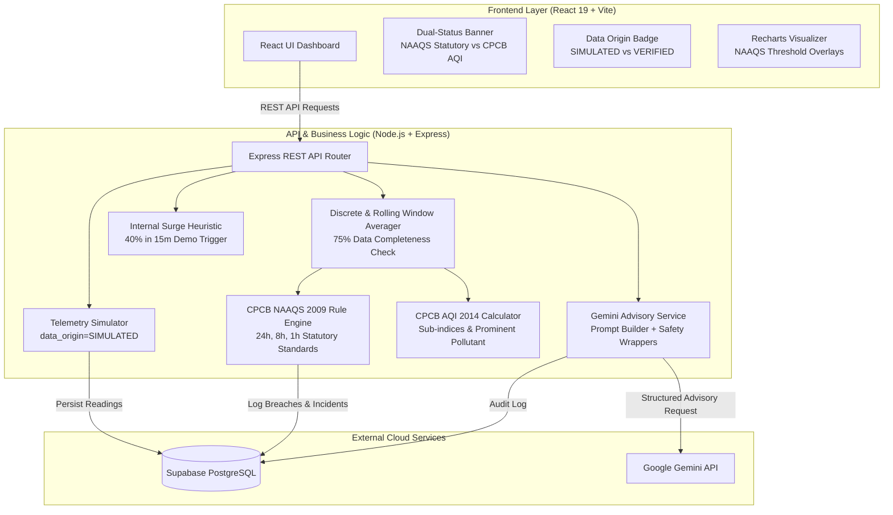

# EcoSentinel AI - Technical Design Document (TDD)

**Project Name:** EcoSentinel AI  
**Architecture:** Decoupled Full-Stack Web Application (SPA + REST API)  
**Stack:** React 19 + Vite (Frontend), Node.js + Express (Backend), Supabase PostgreSQL (Database), Google Gemini API (AI)  
**Regulatory Standards:** CPCB NAAQS 2009 & CPCB National AQI 2014  

---

## 1. System Architecture & High-Level Flow



---

## 2. Regulatory Logic Engine Architecture

### 2.1 CPCB NAAQS Evaluation Logic
*Reference: CPCB Notification No. B-29016/20/90/PCI-L (2009)*

The backend implements `cpcbRulesEngine.js` which evaluates incoming telemetry against the official standards:

```javascript
// CPCB NAAQS 2009 Statutory Standards Definition (Industrial / Residential / Rural)
export const NAAQS_STANDARDS = {
  PM25: {
    pollutant: 'PM2.5',
    unit: 'µg/m³',
    standards: {
      '24h': 60,
      annual: 40 // Future Scope: requires >= 104 samples/year
    }
  },
  PM10: {
    pollutant: 'PM10',
    unit: 'µg/m³',
    standards: {
      '24h': 100,
      annual: 60 // Future Scope
    }
  },
  SO2: {
    pollutant: 'SO2',
    unit: 'µg/m³',
    standards: {
      '24h': 80,
      annual: 50 // Future Scope
    }
  },
  NO2: {
    pollutant: 'NO2',
    unit: 'µg/m³',
    standards: {
      '24h': 80,
      annual: 40 // Future Scope
    }
  },
  CO: {
    pollutant: 'CO',
    unit: 'mg/m³',
    standards: {
      '8h': 2.0,
      '1h': 4.0
    }
  },
  O3: {
    pollutant: 'O3',
    unit: 'µg/m³',
    standards: {
      '8h': 100,
      '1h': 180
    }
  }
};
```

### 2.2 Averaging Calculation Strategy
1. **Discrete Statutory 24-Hour Block:**
   * Window: 24-hour monitoring block (or continuous 24-hr sampling).
   * Data Completeness: Requires at least **$75\%$ valid hourly samples** ($18$ valid hours out of $24$). If $<75\%$, flag as `INSUFFICIENT_DATA_CAPTURE`.
2. **Operational Rolling Average (Real-time Engineering Early Warning):**
   * Trailing 24-hour mean for $\text{PM}_{2.5}$, $\text{PM}_{10}$, $\text{SO}_2$, $\text{NO}_2$.
   * Trailing 8-hour mean for $\text{CO}$ and $\text{O}_3$.
   * Trailing 1-hour mean for $\text{CO}$ and $\text{O}_3$ peak exposure checks.

### 2.3 Official CPCB AQI Calculation Engine
*Reference: CPCB National Air Quality Index Technical Manual (2014)*

Implemented in `aqiCalculator.js`:
* Evaluates individual sub-indices ($I_i$) using official CPCB piecewise breakpoints.
* Respects official CPCB pollutant averaging periods:
  * $\text{PM}_{2.5}$: 24-hr mean concentration.
  * $\text{PM}_{10}$: 24-hr mean concentration.
  * $\text{SO}_2$: 24-hr mean concentration.
  * $\text{NO}_2$: 24-hr mean concentration.
  * $\text{CO}$: 8-hr mean concentration ($\text{mg}/\text{m}^3$).
  * $\text{O}_3$: 8-hr mean concentration.
* Validates CPCB composition criteria:
  * At least **3 pollutants** must be available.
  * At least **one particulate parameter** ($\text{PM}_{2.5}$ or $\text{PM}_{10}$) must be present.
* Determines the **Prominent Pollutant**: the pollutant with the maximum sub-index ($I_{\text{prominent}} = \max(I_i)$).

---

## 3. Data Provenance & Anomaly Heuristics

### 3.1 Data Provenance Architecture
Every record ingested into Supabase and emitted via the REST API contains:
```json
{
  "data_origin": "SIMULATED",
  "is_simulated": true,
  "station_code": "STA-GJ-VAPI-01"
}
```
* **Client Rendering:** `<DataOriginBadge origin="SIMULATED" />` renders an amber tag `[SIMULATED DATA]` across all views.
* **Production Path:** In future production environments, when physical CAAQMS station feeds are ingested via CPCB CCR APIs, `data_origin` is set to `VERIFIED_MONITORING` and `is_simulated` to `false`.

### 3.2 Internal Demonstration Anomaly Heuristic
* `anomalyService.js` implements the **Internal Surge Heuristic**:
  $$\text{Surge Ratio} = \frac{C_{\text{instant}} - C_{\text{1h\_baseline}}}{C_{\text{1h\_baseline}}}$$
  If $\text{Surge Ratio} \ge 0.40$ ($40\%$ increase within 15 minutes), emit an alert: `OPERATIONAL SURGE DETECTED (Internal Heuristic)`.
* **Important Disclaimer in UI & Logs:** *This alert is triggered by EcoSentinel AI's internal demonstration heuristic for rapid industrial spike detection and does not represent an official CPCB regulatory standard.*

---

## 4. Gemini AI Integration & Prompt Engineering

### 4.1 Integration Pattern
The backend uses `@google/genai` (or direct Google GenAI REST endpoint) configured via `BACKEND/.env` with `GEMINI_API_KEY`. The model used is `gemini-2.5-flash` or `gemini-1.5-flash` for low latency ($<3$ seconds).

### 4.2 System Instruction & Schema Enforcement
```javascript
const systemInstruction = `
You are EcoSentinel AI's Senior Industrial Environmental Compliance Specialist.
Your objective is to provide actionable technical root-cause hypotheses and operational mitigation steps (CAPA) when ambient air parameters exceed permissible CPCB statutory limits.

STRICT CONSTRAINTS:
1. Provide practical industrial engineering guidance (e.g. check wet scrubber liquor pH, inspect baghouse filter differential pressure, optimize furnace fuel-air ratio).
2. Explicitly reference relevant CPCB industrial standards.
3. Keep output strictly in valid JSON format matching the schema.
4. Output must emphasize that recommendations are advisory only and do NOT constitute legal clearance or an official regulatory order under CPCB or State Pollution Control Boards.
`;
```

### 4.3 Structured Response Contract
```json
{
  "incident_id": "uuid",
  "pollutant": "SO2",
  "recorded_value": 94.5,
  "standard_limit": 80.0,
  "unit": "µg/m³",
  "averaging_period": "24 Hours",
  "probable_root_causes": [
    "Flue gas desulphurization (FGD) scrubber caustic dosing pump failure",
    "High-sulphur furnace oil batch utilized without flue gas scrubbing"
  ],
  "immediate_mitigation_steps": [
    "Check caustic soda (NaOH) recirculation rate and maintain scrubbing slurry pH 8.0-8.5",
    "Reduce boiler combustion load by 20% until scrubber differential pressure normalizes"
  ],
  "long_term_capa": [
    "Install dual redundant alkali dosing pumps with auto-switchover",
    "Mandate fuel supplier test certificates for sulphur content (<1.5% wt)"
  ],
  "cpcb_reference": "CPCB Environmental Standards for Industrial Boilers and Chemical Processing",
  "disclaimer": "ADVISORY NOTICE: Recommendations provided by EcoSentinel AI are technical and operational suggestions for internal decision-support. They do not constitute official statutory compliance determinations or certified legal clearance under Central or State Pollution Control Board regulations."
}
```

---

## 5. REST API Endpoints Specification

| Method | Endpoint | Query / Body | Description |
| :--- | :--- | :--- | :--- |
| `GET` | `/api/health` | None | Service heartbeat & version info. |
| `GET` | `/api/stations` | None | Returns list of stations with geographic and operational metadata. |
| `GET` | `/api/telemetry/latest` | `?station_id=uuid` | Instantaneous readings, statutory averages, CPCB AQI, `data_origin: "SIMULATED"`. |
| `GET` | `/api/telemetry/history` | `?station_id=uuid&hours=24` | Historical time-series points with data completeness percentage. |
| `POST` | `/api/telemetry/simulate-tick` | `{ station_id, scenario }` | Triggers a simulated telemetry update (`normal`, `so2_spike`, `pm_surge`). |
| `GET` | `/api/compliance/status` | `?station_id=uuid` | Comprehensive check against 24h, 8h, and 1h NAAQS limits. |
| `GET` | `/api/incidents` | `?status=OPEN&station_id=uuid` | Lists pollution breach incidents with severity. |
| `POST` | `/api/incidents` | `{ station_id, pollutant, recorded_value, notes }` | Manually logs an incident ticket. |
| `PATCH` | `/api/incidents/:id` | `{ status, resolution_notes }` | Transitions incident state (`OPEN` to `MITIGATED` to `CLOSED`). |
| `POST` | `/api/advisory/generate` | `{ incident_id: "uuid" }` | Generates Gemini AI root-cause analysis & CAPA checklist. |

---

## 6. Single-Developer Hackathon Feasibility Matrix

To ensure the MVP is completed smoothly by a solo developer during the hackathon, technical complexity is kept disciplined:

| Module | Hackathon MVP Implementation | Deferred Post-MVP Complexity |
| :--- | :--- | :--- |
| **Telemetry Ingestion** | In-memory simulator + Supabase storage | Hardware IoT gateway integration, MQTT broker |
| **Averaging Engine** | Lightweight SQL window queries + rolling arrays | Distributed streaming pipeline (Kafka / Flink) |
| **Compliance Checking** | Parameterized CPCB 2009 lookup table | Multi-state SPCB local consent rule engine |
| **AQI Calculator** | Pure JS CPCB piecewise linear function | Real-time multi-station interpolation maps |
| **Forecasting** | Linear regression on last 12 hours of data | Deep learning LSTM / Prophet neural forecasting |
| **AI Advisory** | Single-turn Gemini prompt with structured JSON | RAG vector database indexing full CPCB gazettes |
| **Styling & UI** | Tailwind CSS + Lucide React + Recharts | Custom WebGL 3D industrial plant twins |
